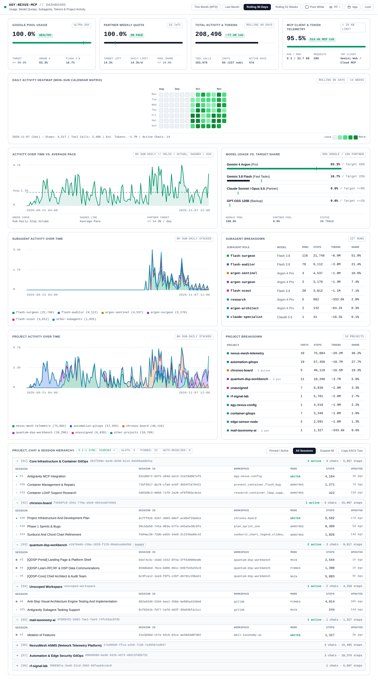
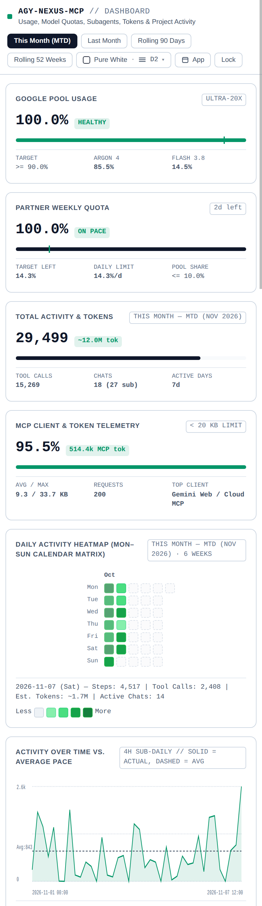

# `agy-nexus-mcp` — Connect Google Gemini to Your Antigravity IDE, Projects & Usage Dashboard (`v2.4.0`)

`agy-nexus-mcp` is a self-hosted Model Context Protocol (MCP) server that connects **Google Gemini** (on the web or mobile app) directly to your local **Google Antigravity IDE / CLI** workstation.

From your phone or browser, you can check on running coding sessions, inspect a copy-ready **76-column Project $\rightarrow$ Chat $\rightarrow$ Session ID hierarchy**, see what a paused session is waiting for, search and read local repository files with **parallel session isolation**, inspect screenshots/visual artifacts via signed URLs, send research plans straight into the right project chat, view **three-tier ASCII usage stats** in chat, or open the **installable Chromium Web App (`/web`)** for live charts and model quota tracking.

---

## Live `/web` Dashboard & Installable Chromium App



<details>
<summary><strong>📱 View Mobile Layout (Centered <code>This Month — MTD</code> Calendar, Responsive Cards &amp; Session Hierarchy)</strong></summary>

<br/>



</details>

---

## Best Features & Advantages

### 1. Control Parallel Coding Sessions Without Cross-Talk (`v2.4.0`)
- **Parallel Session Isolation & Keyed Context Slots**: Multiple Gemini Web and Gemini Mobile tabs can work concurrently on different repositories and conversations without overwriting each other's active workspace (`session_identifier` and `workspace` pinning backed by `fcntl.flock` atomic state slots).
- **3-Tier Smart Path Resolver**: Pass relative paths, repo-prefixed paths (`quantum-dsp-workbench/src/fft.py`), or unique subpaths across your workspace root—`ask_workspace_readonly` resolves the target repository automatically without requiring redundant session switches.
- **Same-Repo Concurrent Writer Guard**: Detects when another Antigravity session is actively `RUNNING` on the same repository, labeling sessions as `MAIN WRITER`, `WORKTREE`, `SHARED (READ-ONLY)`, or `MAIN TREE` and recommending `use_worktree=True` before dispatching concurrent edits.
- **76-Column Copy-Ready Session Hierarchy (`get_session_tree`)**: Renders a complete `Project -> Chat -> Session ID -> Workspace -> Status` tree with untruncated UUIDs and paths so you can copy any `session_id` or `project_id` in one click.

### 2. Built for Reliability on Gemini Web & Mobile
- **Strict Single-Call-Per-Turn Architecture**: Google Gemini's web and mobile confirmation cards can hang on `"Trying to connect..."` if an MCP server forces back-to-back tool calls in the same turn. Every tool in `agy-nexus-mcp` bundles the context you need into a single `< 20 KB` wire-budgeted turn.
- **Autonomous Multi-File Research**: Reads up to 12 files (`14,000` chars per file, `< 19.2 KB` progressive wire compaction) or auto-reads the top 4 matching files from a `git grep` search in a single `ask_workspace_readonly` call, with targeted line-range slicing (`src/app.py:100-250`) and paged git diffs.
- **Ephemeral HMAC-Signed Visual Artifact Links (`/web/media/`)**: Exposes repository PNG/WebP/SVG assets and Chrome DevTools screenshots via 30-minute HMAC-SHA256 signed URLs (`visual_artifacts` in `load_session_into_gemini` and `ask_workspace_readonly`) without blowing up JSON-RPC payloads.
- **Voice-Friendly Passphrase Lock**: Protected by a randomized URL path plus an interactive passphrase lock (`unlock_sessions`). Strips punctuation and voice filler (like *"The passphrase is ..."*) so you can unlock it hands-free using Gemini Live or Mobile Voice.

### 3. Installable Chromium App (PWA) & Visual Usage Dashboard (`/web`)
- **One-Click Standalone App**: Open `/web` over HTTPS and click the top-bar **`App`** button to install the dashboard as a native-feeling **Chromium Standalone App** on desktop or mobile (or copy the `--app=` terminal launcher).
- **Unified Project, Chat & Session Hierarchy Panel (`col-12`)**: Inspect every project, active/pinned slot, `SHARED REPO` badge, and 3-2-1 backup sync status (`3-2-1 SYNC: 55d0304 ✓`) with 1-click inline copy for `project_id`, `session_id`, chat title, and `workspace`.
- **Locked X-Axes & Local-Timezone `4h` Stacked Charts**: Activity velocity, subagent runs, and project token stacks are bucketed in local timezone and locked to the exact same X-axis window across **`This Month (MTD)`**, **`Last Month`**, **`Rolling 90 Days`**, and **`Rolling 52 Weeks`**.
- **4 Themes & 4 Spacing Modes**: Choose between `Obsidian`, `Dark Paper`, `Warm Paper`, and `Pure White` themes alongside 4 compactness levels (`D1`–`D4`) in a single dropdown.

---

## How to Set It Up & Use It

### Step 1: Run the Setup Script
Clone the repository on your workstation and run the interactive setup script to generate your passphrase hash, secret URL path, and local service config:

```bash
# Linux / macOS / WSL
./scripts/setup.sh

# Windows PowerShell
.\scripts\setup.ps1
```

Or run the self-test and start the server directly with `uv` or Python:

```bash
python3 scripts/init_secrets.py --passphrase "your-secret-passphrase"
python3 ag_bridge.py --self-test
python3 ag_bridge.py
```

*(See [docs/DEPLOYMENT.md](docs/DEPLOYMENT.md) for Docker Compose, reverse proxy, Cloudflare Tunnel, and 3-2-1 backup setup.)*

### Step 2: Connect It in Google Gemini
1. Open **Google Gemini** on the web $\rightarrow$ **Settings** $\rightarrow$ **Connected Apps** $\rightarrow$ **Add custom MCP server**.
2. Paste your secret MCP endpoint URL:
   `https://<your-subdomain>.<your-domain>/{PATH_SECRET}/mcp`
3. Open your dashboard in any browser at:
   `https://<your-dashboard-host>/web`

### Step 3: Everyday Prompts You Can Use in Gemini
Once connected, just talk or type naturally in Gemini Web or Gemini Mobile:
- **Unlock & check status**: *"Unlock Antigravity with passphrase [your phrase] and show me my active sessions."*
- **View the Project & Session ID Tree**: *"Show me my session tree so I can copy the session ID and project ID."*
- **Inspect a session in one shot**: *"Load session `quantum-dsp-workbench` and tell me what it's working on or waiting for."*
- **Search & read code across parallel tabs**: *"Search `automation-gitops` for the compose healthcheck rules and read the matching files."*
- **Audit uncommitted git changes**: *"Check git diff across all my repositories to see what hasn't been committed yet."*
- **Send a plan back to Antigravity**: *"Send this implementation plan to my `quantum-dsp-workbench` session and wake it up in plan mode."*
- **View ASCII stats in chat**: *"Show me my latest usage stats"* (or ask for `quick` mobile view or `rich` desktop view).

---

## Copy-Ready 76-Column Project, Chat & Session Hierarchy (`get_session_tree`)

Call `get_session_tree()` (or `manage_background_run(action="sessions")`) to render a copy-ready 76-column ASCII hierarchy grouping every conversation under its parent project with **untruncated** `project_id`, `session_id`, and `workspace` lines, parallel context slot counters, and 3-2-1 backup verification:

```text
╔══════════════════════════════════════════════════════════════════════════╗
║ AGY-NEXUS // PROJECT -> CHAT -> SESSION ID HIERARCHY (COPY-READY)        ║
╠══════════════════════════════════════════════════════════════════════════╣
║ ACTIVE SLOTS: 5 | PINNED: 22 | AUTO-PATH: 6 | TTL: 119.5m                ║
║ 3-2-1 BACKUP: 55d0304 (SYNCED ✓ · 2263.1 KB · 1h ago)                    ║
╚══════════════════════════════════════════════════════════════════════════╝

[PROJECT 1] Core Infrastructure & Container GitOps
  project_id : 491f269e-6a46-6930-b114-8a596add625a
  workspaces : /home/dev/gitlab/container-gitops, /home/dev/gitlab/agy-nexus-config, /home/dev/gitlab/mesh-mesh-infra-ops, /home/dev/.gemini/antigravity/worktrees/container-gitops/prevent_container_flush_bug, /home/dev/.gemini/antigravity/worktrees/container-gitops/research_container_ldap_support
  ├─ [#1] Antigravity MCP Integration
  │   session_id : 031d6672-9375-a94d-ee14-21e19d067ef5
  │   workspace  : /home/dev/gitlab/agy-nexus-config
  │   status     : [● RUNNING] · MAIN WRITER · 4,164 steps · 1m ago
  ├─ [#20] Container Management & Repairs
  │   session_id : 71bf3617-da78-cfad-ec6f-3034f1b76421
  │   workspace  : /home/dev/.gemini/antigravity/worktrees/container-gitops/prevent_container_flush_bug
  │   status     : [○ IDLE] · WORKTREE · 1,271 steps · 7d ago
  └─ [#23] Container LDAP Support Research
      session_id : 5d03d9c3-8668-71f0-2a26-ef9f993c4e1e
      workspace  : /home/dev/.gemini/antigravity/worktrees/container-gitops/research_container_ldap_support
      status     : [○ IDLE] · WORKTREE · 422 steps · 13d ago

[PROJECT 2] chronos-board
  project_id : f45b9fc8-3341-770a-a5e9-6b51edd7d403
  workspaces : /home/dev/chronos-board, /home/dev/.gemini/antigravity/worktrees/chronos-board/plan_sprint_one, /home/dev/.gemini/antigravity/worktrees/chronos-board/sunburst_chart_legend_slideout, /home/dev/.gemini/antigravity/worktrees/chronos-board/collect_phase_one_ux, /home/dev/.gemini/antigravity/worktrees/chronos-board/chronos-board_business_case
  ├─ [#28] Project Infrastructure And Development Plan
  │   session_id : 6cfff61b-3207-3d03-60ef-acd0ef2dadce
  │   workspace  : /home/dev/chronos-board
  │   status     : [● RUNNING] · MAIN WRITER · 5,592 steps · 17d ago
  ├─ [#18] Phase 1 Sprints & Bugs
  │   session_id : 96c5da58-741a-063a-b7fa-d45a5e38c0fe
  │   workspace  : /home/dev/.gemini/antigravity/worktrees/chronos-board/plan_sprint_one
  │   status     : [○ IDLE] · WORKTREE · 8,389 steps · 5d ago
  └─ [#24] Sunburst And Chord Chart Refinement
      session_id : fe94ac36-73db-ed55-54e8-2c2240a80c42
      workspace  : /home/dev/.gemini/antigravity/worktrees/chronos-board/sunburst_chart_legend_slideout
      status     : [○ IDLE] · WORKTREE · 1,026 steps · 14d ago

[PROJECT 3] quantum-dsp-workbench [SHARED REPO]
  project_id : e1676a6d-c5ba-1829-f129-86a6cea0e5bd
  workspaces : /home/dev/gitlab/quantum-dsp-workbench
  ├─ [#3] [QDSP-Portal] Landing Page & Platform Shell
  │   session_id : b5e74c3c-15dd-1552-8f4a-5ff63090b4db
  │   workspace  : /home/dev/gitlab/quantum-dsp-workbench
  │   status     : [◉ PINNED · IDLE] · MAIN TREE · 2,544 steps · 1h ago
  ├─ [#4] [QDSP-Learn-RF] RF & DSP Data Communications
  │   session_id : 859dbded-76ce-bd86-861c-8397545e55c8
  │   workspace  : /home/dev/gitlab/quantum-dsp-workbench
  │   status     : [◉ PINNED · IDLE] · PINNED (READ-ONLY) · 1,390 steps · 1h ago
  └─ [#5] [QDSP-Core] Chief Architect & Audit Team
      session_id : bc9fca12-1ee9-f0f5-c26f-66781c29ba51
      workspace  : /home/dev/gitlab/quantum-dsp-workbench
      status     : [○ COMPLETED] · MAIN TREE · 5,883 steps · 5h ago

[PROJECT 4] Unscoped Workspace
  project_id : unscoped-workspace
  workspaces : /home/dev/gitlab
  ├─ [#6] Anti-Slop Visual Architecture Engine Testing And Implementation
  │   session_id : 882e8349-52d4-bee1-35bb-6e985a4150e8
  │   workspace  : /home/dev/gitlab
  │   status     : [◉ PINNED · IDLE] · PINNED (READ-ONLY) · 4,014 steps · 10h ago
  └─ [#25] Antigravity Subagent Tasking Support
      session_id : 8cf8341b-fd77-1af6-dd3f-39a63bfa11cc
      workspace  : /home/dev/gitlab
      status     : [○ IDLE] · MAIN TREE · 244 steps · 14d ago

[PROJECT 5] mail-taxonomy-ai
  project_id : 4f009432-b083-7ae1-fae3-74fc93ac6fd5
  workspaces : /home/dev/gitlab/mail-taxonomy-ai
  └─ [#2] Ideation of Features
      session_id : 21e3d46d-c57e-82cb-02ce-ae50d3d6fd02
      workspace  : /home/dev/gitlab/mail-taxonomy-ai
      status     : [◉ PINNED · IDLE] · MAIN WRITER · 1,327 steps · 2m ago

[PROJECT 6] NexusMesh ANMS (Network Telemetry Platform)
  project_id : 17a366d5-ffca-a150-7130-7a36567ed847
  workspaces : /home/dev/gitlab/nexus-mesh-telemetry, /home/dev/.gemini/antigravity/worktrees/nexus-mesh-telemetry/rearchitect_api_strategy_redis, /home/dev/.gemini/antigravity/worktrees/nexus-mesh-telemetry/optimize_canvas_generation_dynamic_devices, /home/dev/.gemini/antigravity/worktrees/nexus-mesh-telemetry/hide_single_node_devices
  ├─ [#17] Redesigning Server Architecture And Strategy
  │   session_id : 2b1f7c7d-8e70-44c1-450b-c981e059f7e3
  │   workspace  : /home/dev/.gemini/antigravity/worktrees/nexus-mesh-telemetry/rearchitect_api_strategy_redis
  │   status     : [○ COMPLETED] · WORKTREE · 1,959 steps · 4d ago
  ├─ [#21] Canvas Node Optimization and Setup
  │   session_id : 6ad3b743-488e-17f8-f998-698ceac4d64d
  │   workspace  : /home/dev/.gemini/antigravity/worktrees/nexus-mesh-telemetry/optimize_canvas_generation_dynamic_devices
  │   status     : [○ IDLE] · WORKTREE · 12,829 steps · 8d ago
  └─ [#29] Filtering Single Unbounded Nodes
      session_id : 8c40259a-ba02-976b-0fea-b595d0c72470
      workspace  : /home/dev/.gemini/antigravity/worktrees/nexus-mesh-telemetry/hide_single_node_devices
      status     : [○ IDLE] · WORKTREE · 707 steps · 21d ago

[PROJECT 7] Automation & Edge Security GitOps
  project_id : d9b08096-bed9-3429-4073-40913fd89752
  workspaces : /home/dev/gitlab/automation-gitops, /home/dev/.gemini/antigravity/worktrees/automation-gitops/cam_grid_security_dashboard_migration, /home/dev/.gemini/antigravity/worktrees/automation-gitops/audit_home_automations, /home/dev/.gemini/antigravity/worktrees/automation-gitops/mobile_wall_panel_redesign, /home/dev/.gemini/antigravity/worktrees/automation-gitops/orbital_ember_rolls_11h46
  ├─ [#7] Security Automation DevSecOps (& Audit Cron)
  │   session_id : d7590de0-5a72-be58-b123-c77c1a76f1dd
  │   workspace  : /home/dev/.gemini/antigravity/worktrees/automation-gitops/cam_grid_security_dashboard_migration
  │   status     : [○ IDLE] · WORKTREE · 4,314 steps · 11h ago
  ├─ [#8] Home Automation DevOps (& Audit Cron)
  │   session_id : 11822340-57c1-2caf-e121-f55e3f0105db
  │   workspace  : /home/dev/.gemini/antigravity/worktrees/automation-gitops/audit_home_automations
  │   status     : [○ IDLE] · WORKTREE · 4,813 steps · 11h ago
  └─ [#19] Mobile Automation Edge Dashboard Redesign
      session_id : 8c12f68a-76d4-898d-c0ea-dca7246f244d
      workspace  : /home/dev/.gemini/antigravity/worktrees/automation-gitops/mobile_wall_panel_redesign
      status     : [○ IDLE] · WORKTREE · 1,249 steps · 6d ago

[PROJECT 8] rf-signal-lab
  project_id : 7068307a-2ee8-21cd-2002-85faad4ccbc9
  workspaces : /home/dev/gitlab/rf-signal-lab
  └─ [#22] RF Lab Edition 6
      session_id : 13977fe1-0589-276b-fec0-ba77614900c9
      workspace  : /home/dev/gitlab/rf-signal-lab
      status     : [○ IDLE] · MAIN TREE · 5,097 steps · 8d ago
```

---

## Three-Tier ASCII Usage Reports in Chat

When you ask Gemini for your usage stats (`manage_background_run(action="stats", period="last_90d", style=...)`), `agy-nexus-mcp` formats your live quota pools, `Mon–Sun` calendar heatmap, 8-hour activity curve, and project/subagent token breakdowns into one of **three plain-text layouts**:

| Style | Width | Best For | What It Shows |
| :--- | :---: | :--- | :--- |
| **`style="default"`** | **72 cols** | Standard Desktop & Tablet Chat | Split summary header, 22-week `Mon–Sun` heatmap, 8-hour activity & project stack (`░▒▓█`), model quota bars (`┼`), and full project & subagent tables. |
| **`style="quick"`** | **`<= 40` cols** | Phone Screens (Portrait) | Fits strictly within 40 characters per line so it never wraps on mobile. Shows a 13-week heatmap, 8-hour pace curve, model quota bars, and top projects/subagents. |
| **`style="rich"`** | **76 cols** | Widescreen Desktop Chat | Full box-drawn dashboard (`v2.4.0`) with side-by-side quota and token panels, 13-week 3-character heatmap with a Peak Day card, 6-row 8-hour activity curve, and share gauges. |

### 1. `style="default"` (72-Column Standard Layout)

```text
════════════════════════════════════════╤═══════════════════════════════
AGY-NEXUS // 90d (Nov 07 ◄── Aug 10)    ┆ EXTENDED TELEMETRY & AVERAGES 
════════════════════════════════════════╪═══════════════════════════════
GOOGLE 20x : 100.0% [████████┼█] HEALTHY┆ 0x 429s | Ultra-20x (T:>=90%) 
PARTNER 1x : 100.0% [░┼░░░░░░░░] ON PACE┆ 14.3% Wk Left | Lim <=14.3%/d 
STEPS/TOOLS: 208,496s | 103,976t | 65c  ┆ 4,436 s/act-d | 2,316 s/cal-d 
TOKEN BURN : ~77.4M Total (227 sub runs)┆ 1.65M tok/d   | 11.5M tok/wk  
MCP WIRE   : 96% <20KB (avg 9.3/33.7KB) ┆ 200 req (514k tok) | Gemini We
────────────────────────────────────────┴───────────────────────────────
DAILY HEATMAP (NOW: W01 ──► 22w AGO)   Peak: 10/31 (10,964s) | Act: 47d
Wk    01 02 03 04 05 06 07 08 09 10 11 12 13 14 15 16 17 18 19 20 21 22
Mon   ▒▒ ██ ░░ ▒▒ ▓▓ ▒▒ ·· ·· ·· ·· ·· ·· ·· ·· ·· ·· ·· ·· ·· ·· ·· ··
Tue   ▒▒ ▓▓ ▒▒ ▒▒ ▒▒ ░░ ░░ ·· ·· ·· ·· ·· ·· ·· ·· ·· ·· ·· ·· ·· ·· ··
Wed   ▓▓ ██ ░░ ░░ ▒▒ ▓▓ ░░ ·· ·· ·· ·· ·· ·· ·· ·· ·· ·· ·· ·· ·· ·· ··
Thu   ░░ ▓▓ ░░ ▒▒ ▓▓ ██ ░░ ·· ·· ·· ·· ·· ·· ·· ·· ·· ·· ·· ·· ·· ·· ··
Fri   ▓▓ ▓▓ ██ ▒▒ ░░ ██ ██ ·· ·· ·· ·· ·· ·· ·· ·· ·· ·· ·· ·· ·· ·· ··
Sat   ▓▓ ██ ██ ░░ ▒▒ ██ ██ ·· ·· ·· ·· ·· ·· ·· ·· ·· ·· ·· ·· ·· ·· ··
Sun   ·· ▓▓ ██ ▓▓ ▓▓ ██ ▒▒ ·· ·· ·· ·· ·· ·· ·· ·· ·· ·· ·· ·· ·· ·· ··
Vol   ▄▄ ██ ▆▆ ▃▃ ▄▄ ▆▆ ▃▃ ── ── ── ── ── ── ── ── ── ── ── ── ── ── ──
────────────────────────────────────────────────────────────────────────
8H SUB-DAILY PACE (NOW ──► SEP 21)   [Avg: 1.6k/8h | Peak: 4.5k | ░▒▓█]
4.5k ╷                 ▄█ █                                            
2.4k ┤█                █████  ▄                     ██  ▄      ▄▄      
1.6k ┼██▄─────▄██─█▄──██████──█──────█───█─▄█──█─▄──██─██▄▄──▄─██──────
   0 ╵░▓▓ ▓▓▓▄█▒▓▓█▒▓▄███▒▒▒  ▒▄ ▒▄▄▄██▄ █▄██ ██▄██ ████▓▓▓ ▓▓▄▓▓▓▄  ▄ 
     └─▲────────────▲────────────▲────────────▲────────────▲──────────▲─
      Nov 07       Oct 29       Oct 19       Oct 09       Sep 30     Sep
      Stack: [█] nexus-mesh-te (36%)  [▓] automation-gi (28%)  [▒] chron
────────────────────────────────────────────────────────────────────────
MODEL QUOTA vs TARGET (┼ = Target Pin)      CALLS   EST TOK  DELTA  STAT
Argon 4 Pro [████████████┼████▓░░]  83.3%   83,381    ~21.3M +18.3%  WAR
Flash 3.8   [███▓░┼░░░░░░░░░░░░░░]  16.7%   16,707     ~3.7M  -8.3%  OK
Claude 5.5  [░░┼░░░░░░░░░░░░░░░░░]   0.0%       12     ~4.1k  -8.0%  OK
GPT-OSS 120 [▏░░░░░░░░░░░░░░░░░░░]   0.0%        0         0  -2.0%  OK
────────────────────────────────────────────────────────────────────────
WORKSPACES (11)     CHATS   STEPS   TOTAL TOK  TOK/DAY   TOK/WK   SHARE
1. nexus-mesh-telem  10c  75,084     ~29.2M     621k    4.35M   36.0%
2. automation-gitop  19c  57,456     ~18.7M     398k    2.79M   27.6%
3. chronos-board      5c  40,110     ~16.5M     351k    2.46M   19.2%
4. quantum-dsp-work  11c  10,298      ~3.7M      78k     548k    4.9%
5. unassigned         7c   6,839      ~2.8M      59k     412k    3.3%
6. rf-signal-lab      1c   5,701      ~2.0M      42k     294k    2.7%
7. agy-nexus-config   1c   4,518      ~1.9M      40k     281k    2.2%
8. container-gitops   7c   3,346      ~1.0M      22k     152k    1.6%
9. edge-sensor-node   2c   2,691      ~1.0M      21k     150k    1.3%
10. mail-taxonomy-a   1c   1,327      ~344k     7.3k      51k    0.6%
11. orbital-optics    1c   1,126      ~294k     6.3k      44k    0.5%
────────────────────────────────────────────────────────────────────────
SUBAGENTS (8)        RUNS   STEPS   TOTAL TOK  TOK/DAY   TOK/WK   SHARE
1. flash-surgeon    116r  21,746      ~8.9M     190k    1.33M   51.0%
2. flash-auditor     78r   9,112      ~3.0M      64k     450k   21.4%
3. argon-sentinel     3r   4,537      ~1.9M      41k     285k   10.6%
4. argon-surgeon      2r   3,170      ~1.3M      28k     196k    7.4%
5. flash-scout       20r   3,012      ~1.1M      24k     170k    7.1%
6. research           5r     862      ~333k     7.1k      50k    2.0%
7. argon-architect    2r     132     ~64.2k     1.4k     9.6k    0.3%
8. claude-specialis   1r      31     ~16.3k      347     2.4k    0.1%
════════════════════════════════════════════════════════════════════════
```

### 2. `style="quick"` (40-Column Mobile Layout)

```text
════════════════════════════════════════
AGY-NEXUS // 90d (Nov 07 ◄── Aug 10)
════════════════════════════════════════
G-20x: 100% [████████┼█] OK | 0x 429s
P-1x : 100% [░┼░░░░░░░░] OK | 14% WkLft
Steps:208.5k | Tools:104.0k | Act:47d
Burns:~77.4M | 1.65M/d | 11.5M/wk
────────────────────────────────────────
HEATMAP (NOW ──► 13w Ago)  │ PEAK & VOL
Mo ▒█░▒▓▒·······           │ Pk: 10/31
Tu ▒▓▒▒▒░░······           │ 10,964 stp
We ▓█░░▒▓░······           │ Avg:4,436/d
Th ░▓░▒▓█░······           │ Chats: 65c
Fr ▓▓█▒░██······           │ Subs : 227r
Sa ▓██░▒██······           │ Tok/d:1.65M
Su ·▓█▓▓█▒······           │ Tok/w:11.5M
────────────────────────────────────────
8H PACE & STACK (NOW──►OLD) Pk:3.7k
3.7k╷█        █                      
1.8k┤█   ▄▄ ▄ █     ▄ ▄       ▄  █   
1.5k┼███▄██─█─█▄────█─██─▄─██▄█──█───
   0╵░▓░▓█▓████▒▄ ▒▄█▄██▄█ ███▓▓▓▓▄▄ 
────────────────────────────────────────
MODEL QUOTA (┼=Target)  PCT   TOK   DLT
Argon 4 [██████┼█▓░]  83% 21.3M  +18%
Flash38 [██┼░░░░░░░]  17%  3.7M   -8%
Claude5 [░┼░░░░░░░░]   0%  4.1k   -8%
GPT-120 [▏░░░░░░░░░]   0%     0   -2%
────────────────────────────────────────
WORKSPACES & SUBS  TOK   TOK/D   TOK/WK
nexus-mesh-telem 29.2M   621k   4.35M
automation-gitop 18.7M   398k   2.79M
chronos-board    16.5M   351k   2.46M
quantum-dsp-work  3.7M    78k    548k
unassigned        2.8M    59k    412k
rf-signal-lab     2.0M    42k    294k
*flash-surgeon    8.9M   190k   1.33M
*flash-auditor    3.0M    64k    450k
*argon-sentinel   1.9M    41k    285k
════════════════════════════════════════
```

### 3. `style="rich"` (76-Column Widescreen Layout)

```text
╔══════════════════════════════════════════════════════════════════════════╗
║ ▄▀█ █▀▀ █▄█ ▄▄ █▄░█ █▀▀ ▀▄▀ █░█ █▀   v2.4.0 // RICH TELEMETRY RIG        ║
║ █▀█ █▄█ ░█░ ░░ █░▀█ ██▄ █░█ █▄█ ▄█   WINDOW: 90d (Nov 07 ◄── Aug 10)     ║
╠════════════════════════════════════╦═════════════════════════════════════╣
║ QUOTA POOLS & 429 COOLDOWNS        │ STEP & TOOL VELOCITY                ║
║ G-20x: 100.0% [████████┼█] OK      │ Total : 208,496 steps | 103,976 too ║
║ P-1x : 100.0% [░┼░░░░░░░░] OK      │ Active: 4,436 s/act-d (47d active)  ║
║ 429s : 0 events | 14.3% Wk Left    │ Calend: 2,316 s/cal-d (65c, 227r)   ║
╠════════════════════════════════════╬═════════════════════════════════════╣
║ TOKEN BURN & ROLLING AVERAGES      │ MCP WIRE & CLIENT SURFACES          ║
║ Total : ~77.4M (~70.4M direct)     │ Wire  : 96% <20KB (avg 9.3/33.7KB)  ║
║ Daily : 1.65M tok/act-d            │ Calls : 200 MCP reqs (514k tok)     ║
║ Weekly: 11.5M tok/wk               │ Client: Gemini Web (100% / 0 Mob)   ║
╠════════════════════════════════════╩═════════════════════════════════════╣
║ DAILY ACTIVITY MATRIX (NOW: W01 ──► W13)     [·· 0  ░░ <1k  ▒▒ <4k  ██]  ║
║ Wk   W01 W02 W03 W04 W05 W06 W07 W08 W09 W10 W11 W12 W13  ┌─ PEAK DAY ─┐ ║
║ Mon  ▒▒▒ ███ ░░░ ▒▒▒ ▓▓▓ ▒▒▒ ··· ··· ··· ··· ··· ··· ···  │ Oct 31     │ ║
║ Tue  ▒▒▒ ▓▓▓ ▒▒▒ ▒▒▒ ▒▒▒ ░░░ ░░░ ··· ··· ··· ··· ··· ···  │ 10,964 stp │ ║
║ Wed  ▓▓▓ ███ ░░░ ░░░ ▒▒▒ ▓▓▓ ░░░ ··· ··· ··· ··· ··· ···  ├────────────┤ ║
║ Thu  ░░░ ▓▓▓ ░░░ ▒▒▒ ▓▓▓ ███ ░░░ ··· ··· ··· ··· ··· ···  │ Act: 47d   │ ║
║ Fri  ▓▓▓ ▓▓▓ ███ ▒▒▒ ░░░ ███ ███ ··· ··· ··· ··· ··· ···  │ Avg:  4.4k │ ║
║ Sat  ▓▓▓ ███ ███ ░░░ ▒▒▒ ███ ███ ··· ··· ··· ··· ··· ···  │ Sub: 227r  │ ║
║ Sun  ··· ▓▓▓ ███ ▓▓▓ ▓▓▓ ███ ▒▒▒ ··· ··· ··· ··· ··· ···  └────────────┘ ║
║ Vol  ▄▄▄ ███ ▆▆▆ ▃▃▃ ▄▄▄ ▆▆▆ ▃▃▃ ─── ─── ─── ─── ─── ───  PeakWk:45.0k   ║
║ Steps 24k 45k 36k 20k 26k 38k 20k  ·   ·   ·   ·   ·   ·                 ║
╠══════════════════════════════════════════════════════════════════════════╣
║ 8H SUB-DAILY HORIZON CURVE & PROJECT STACK (NOW ──► SEP 21)              ║
║ 3.8k ╷█        █   ▄   ▄ █                         ▄                     ║
║ 3.0k ┤█        █   █   █ █                         █   ▄      █          ║
║ 2.1k ┤█▄      ▄██  █   █ █       █  ▄         ▄    █  ██ ▄    ██         ║
║ 1.4k ┼███─█───███──█───█─█───────█──█─────█───█────█─▄██▄█──▄─██──────   ║
║  685 ┤███ ███ ███▄▄█▄ ▄████ █   ▄█  █  █▄ ██  ██▄  █▄█████ ▄█▄██▄        ║
║    0 ╵░▓▓▄░▓▓▄█▓▓▓██▓▄█▒█▒▒ ▒▄▄▒▒█▒██▄▄█▓▄██ ▄███ ▄████▓█▓▄▓▓▓▓▓▓▄▄▄▄    ║
║      └─▲───────────▲───────────▲───────────▲───────────▲───────────▲───  ║
║       Nov 07      Oct 28      Oct 19      Oct 09      Sep 29      Sep 21 ║
║       Stack: [█]nexus-mesh-t(36%)  [▓]automation-g(28%)  [▒]chronos-boar ║
╠══════════════════════════════════════════════════════════════════════════╣
║ MODEL QUOTA vs TARGET (┼ = Target Pin)       CALLS   EST TOK  DELTA STAT ║
║ Argon 4 Pro [█████████████┼███▓░░░]  83.3%  83,381    ~21.3M +18.3%  WRN ║
║ Flash 3.8   [████░┼░░░░░░░░░░░░░░░]  16.7%  16,707     ~3.7M  -8.3%  OK  ║
║ Claude 5.5  [░░┼░░░░░░░░░░░░░░░░░░]   0.0%      12     ~4.1k  -8.0%  OK  ║
║ GPT-OSS 120 [▏░░░░░░░░░░░░░░░░░░░░]   0.0%       0         0  -2.0%  OK  ║
╠══════════════════════════════════════════════════════════════════════════╣
║ WORKSPACES (11)    CHATS   STEPS  TOTAL TOK  TOK/DAY  TOK/WK SHARE GAUGE ║
║ 1. nexus-mesh-tel  10c  75,084     ~29.2M     621k   4.35M ██░░░░ 36.0%  ║
║ 2. automation-git  19c  57,456     ~18.7M     398k   2.79M █▍░░░░ 27.6%  ║
║ 3. chronos-board    5c  40,110     ~16.5M     351k   2.46M █░░░░░ 19.2%  ║
║ 4. quantum-dsp-wo  11c  10,298      ~3.7M      78k    548k ▍░░░░░  4.9%  ║
║ 5. unassigned       7c   6,839      ~2.8M      59k    412k ░░░░░░  3.3%  ║
║ 6. rf-signal-lab    1c   5,701      ~2.0M      42k    294k ░░░░░░  2.7%  ║
║ 7. agy-nexus-conf   1c   4,518      ~1.9M      40k    281k ░░░░░░  2.2%  ║
║ 8. container-gito   7c   3,346      ~1.0M      22k    152k ░░░░░░  1.6%  ║
║ 9. edge-sensor-no   2c   2,691      ~1.0M      21k    150k ░░░░░░  1.3%  ║
║ 10. mail-taxonomy   1c   1,327      ~344k     7.3k     51k ░░░░░░  0.6%  ║
║ 11. orbital-optic   1c   1,126      ~294k     6.3k     44k ░░░░░░  0.5%  ║
╟──────────────────────────────────────────────────────────────────────────╢
║ SUBAGENTS (8)       RUNS   STEPS  TOTAL TOK  TOK/DAY  TOK/WK SHARE GAUGE ║
║ 1. flash-surgeon  116r  21,746      ~8.9M     190k   1.33M ███░░░ 51.0%  ║
║ 2. flash-auditor   78r   9,112      ~3.0M      64k    450k █▍░░░░ 21.4%  ║
║ 3. argon-sentinel   3r   4,537      ~1.9M      41k    285k ▍░░░░░ 10.6%  ║
║ 4. argon-surgeon    2r   3,170      ~1.3M      28k    196k ▍░░░░░  7.4%  ║
║ 5. flash-scout     20r   3,012      ~1.1M      24k    170k ▍░░░░░  7.1%  ║
║ 6. research         5r     862      ~333k     7.1k     50k ░░░░░░  2.0%  ║
║ 7. argon-architec   2r     132     ~64.2k     1.4k    9.6k ░░░░░░  0.3%  ║
║ 8. claude-special   1r      31     ~16.3k      347    2.4k ░░░░░░  0.1%  ║
╚══════════════════════════════════════════════════════════════════════════╝
```

---

## Advanced & Future Workflows: Pairing with Gemini Notebook & Gemini Tasks

When you combine `agy-nexus-mcp` with **Gemini Notebook** (formerly NotebookLM) and **Gemini Tasks** (formerly Spark), Gemini becomes a scheduled, citation-backed control center for your local Antigravity projects:

### 1. Zero-Token Reference Lookup with Gemini Notebook
Normally, if a local coding agent needs to check hardware manuals, API specs, RFCs, or large architecture docs, it spends local steps and model quota reading files.
- **Pre-Flight Context Compression**: Store large reference manuals and specs in **Gemini Notebook**. Ask Gemini to pull the exact cited excerpts from your Notebook first, then send a concise `<= 4,500`-character brief into Antigravity via `send_handoff_and_resume`.
- **Fast Handoffs**: Local agents skip broad file discovery and start coding immediately, while large Notebook briefs automatically write to `scratch/gemini_research_handoff.md` with a compact wakeup prompt so CLI handoffs never time out.

### 2. Scheduled Automation with Gemini Tasks (Spark)
Because Gemini Tasks supports recurring schedules, event triggers, Gemini Notebook, and custom MCP connectors, it can run unattended checks for your local projects:
- **Morning Usage & Audio Briefings**: Schedule a morning Gemini Task to call `manage_background_run(action="stats")`, combine your quota pacing with open tasks, and prepare a morning summary or Notebook Audio Overview.
- **Single-Turn Multi-Repo Drift Audits**: A nightly Gemini Task can call `inspect_git_diff(workspace_override="ALL")` to scan all of your local Git repositories in one turn—flagging uncommitted changes, active branches, or paused sessions without hitting Gemini's single-tool-per-turn limit.
- **Event-Driven Plan Staging**: When an important release note or alert arrives, a triggered Gemini Task can check impact against your Gemini Notebook docs and stage a `plan`-mode handoff (`resume_headless=False`) for you to review.

### 3. Searchable Project Memory (`walkthrough.md` $\rightarrow$ Gemini Notebook Sync)
Every completed Antigravity session produces an `implementation_plan.md` and `walkthrough.md` that normally sit isolated inside individual session UUID folders.
- **Clean Notebook Exports**: Calling `manage_background_run(action="export_notebook")` exports completed session plans and walkthroughs into human-named, dated Markdown files (`YYYY-MM-DD_<repo>_<title>_<id>.md`) inside `sidecar_data/ag-bridge-bg/notebook_exports/` (configurable via `AGY_NOTEBOOK_EXPORT_DIR`).
- **SHA-256 Deduplication (Zero Re-Sync Loops)**: Before writing each file, `export_notebook` checks a SHA-256 hash of the content and skips unchanged sessions (`sync_state="unchanged"`), so syncing that folder to Google Drive and Gemini Notebook never causes duplicate uploads or sync loops.

### 4. Split-Trust Lock Options for Unattended Scheduled Runs
Because `agy-nexus-mcp` requires your interactive passphrase to unlock, a scheduled 6:00 AM Gemini Task would normally hit the lock screen unless you include the passphrase in the task prompt. If you want unattended scheduled tasks without storing your passphrase in a cloud prompt, you can enable two optional split-trust settings in `secrets.env`:
- **`AG_BRIDGE_ALLOW_LOCKED_STATS=true`**: Allows `manage_background_run(action="stats")` to return usage and quota summaries while locked—without exposing any code, file paths, or chat messages.
- **`AG_BRIDGE_ALLOW_LOCKED_STAGING=true`**: Allows `send_handoff_and_resume(..., resume_headless=False)` while locked to save incoming research notes into a quarantine folder (`sidecar_data/ag-bridge-bg/quarantine_handoffs/`), keeping file reads and live execution strictly behind your passphrase.

---

## Available MCP Tools (10 Tools)

| Tool | What It Does |
| :--- | :--- |
| `unlock_sessions(spoken_passphrase, search_query="")` | Verifies your passphrase, unlocks the server, and returns your numbered list of recent Antigravity chats (`1..N`) plus a live usage summary. |
| `lock_bridge()` | Immediately locks the server and clears the active session selection. |
| `list_saved_sessions(limit, status_filter, include_subagents)` | Lists recent Antigravity chats with live status (`RUNNING`, `STALLED_WAITING_APPROVAL`, `COMPLETED`, `IDLE`), waiting approval details, project path, and task summary. |
| `load_session_into_gemini(session_identifier, include_files)` | Opens a chat by number (`"1"`), `#2`, ID prefix, or title keyword in one shot and returns its `task.md`, `implementation_plan.md`, `walkthrough.md`, git status, signed `visual_artifacts`, and recent messages. |
| `get_session_tree(active_only, project_filter, limit)` | Renders the copy-ready 76-column ASCII `Project -> Chat -> Session ID -> Workspace -> Status` hierarchy with untruncated UUIDs, parallel context slots, and 3-2-1 backup status. |
| `ask_workspace_readonly(question, search_query, file_subpath, start_line, end_line, session_identifier, workspace)` | Searches code or reads up to 12 files across the active or pinned project (with 3-tier smart path resolution, line-range support like `src/app.py:100-250`, and signed `visual_artifacts`). |
| `inspect_git_diff(target_branch, include_untracked, workspace_override, file_path, offset_chars, start_line, end_line, session_identifier, workspace)` | Shows the current branch, modified/untracked files, and git diff for a repo—or pass `workspace_override="ALL"` (or `"repo1,repo2"`) to audit all repositories in one turn. |
| `send_handoff_and_resume(research_markdown, resume_headless, session_identifier, workspace_path, project_name, activate_skills, target_agent_role, use_worktree, ...)` | Routes your research notes or implementation plan to the right project session (`scratch/gemini_research_handoff.md`), guards against concurrent same-repo writers, and optionally wakes up Antigravity. |
| `manage_background_run(action, job_id, tail_lines, period, style)` | Checks background session progress (`status`, `tail`, `stop`), renders the 76-column session hierarchy (`action="sessions"`), renders three-tier ASCII stats (`action="stats"`), or exports completed session plans/walkthroughs (`action="export_notebook"`). |
| `list_models_and_agents(include_skills, include_rules, skill_scope_filter, inspect_name)` | Lists your configured Agent Roles, Skills, Rules, and pool quota settings, or reads a specific skill/rule file via `inspect_name`. |

---

## Comparison with Typical Antigravity Bridges

| Feature | Typical Community Bridges (`agy-bridge`, `gemini-antigravity-bridge`, `meridian`, `ag-local-bridge`) | `agy-nexus-mcp` (`v2.4.0`) |
| :--- | :--- | :--- |
| **Connection Type** | Local `stdio` pipe, localhost proxy, or single-chat Telegram/WhatsApp bot | **Streamable HTTP MCP** reachable directly from Google Gemini Web, Mobile & Scheduled Gemini Tasks |
| **Security** | None or static chat-ID allowlist | **Secret URL Path + Voice/Text Passphrase Lock** with optional split-trust staging |
| **Parallel Multi-Chat Isolation** | Single active chat only; parallel tabs overwrite state | **Keyed Context Slots (`active_contexts`) + 3-Tier Smart Path Resolver + Same-Repo Writer Guard** |
| **Web Dashboard & Chromium App** | None | **Installable Chromium Standalone App (`/web`)** with `Mon–Sun` Calendar Heatmap, Project/Chat/Session Hierarchy panel, and 4h/8h Stacked Area Charts |
| **Chat ASCII Usage & Tree Reports** | None | **Three-Tier Monospace ASCII Telemetry** (`default` 72-col, `quick` 40-col mobile, `rich` 76-col desktop) + **76-Col Copy-Ready Session Tree** |
| **Visual Artifact Inspection** | None | **30-Minute HMAC-SHA256 Signed `/web/media/` Image Links** |
| **Large File & Diff Handling** | Raw dumps that can hang cloud proxies | **Automatic `< 20 KB` Wire-Budgeted Responses** with line-range file reads and paged git diffs |

---

## Bundled 8-Agent Orthogonal Roster (`agents/`)

`agy-nexus-mcp` ships with a ready-to-use set of subagent definitions in [`agents/`](agents/) (`flash-scout`, `argon-architect`, `flash-surgeon`, `argon-surgeon`, `flash-auditor`, `argon-sentinel`, `claude-specialist`, `claude-sentinel`).

To install them into your local Antigravity IDE config:

```bash
mkdir -p ~/.gemini/config/agents
cp agents/*.md ~/.gemini/config/agents/
```

As soon as Antigravity runs those subagents, their activity and token usage automatically appear in the `/web` dashboard and ASCII reports. See [`AGENTS.md`](AGENTS.md) and [`agents/README.md`](agents/README.md) for full details.

---

## Repository Layout

```text
agy-nexus-mcp/
├── src/
│   └── agy_nexus/                    # Modular Python package (all modules <= 335 lines)
│       ├── __init__.py               # Package metadata (v2.4.0)
│       ├── config.py                 # Secrets loader, SHA-256 deadbolt & atomic keyed context slots
│       ├── hygiene.py                # <20 KB wire compaction, line-range slicer & diff paginator
│       ├── inventory.py              # Skills, Agent Roles, Rules & workspace discovery
│       ├── telemetry_scanner.py      # Local-TZ transcript & SQLite step/token/subagent/workspace scanner
│       ├── ascii_default.py          # Tier 1 (72-col Default) & Tier 2 (40-col Quick) ASCII renderers
│       ├── ascii_rich.py             # Tier 3 (76-col Rich Widescreen) ASCII renderer
│       ├── session_tree.py           # 76-col ASCII Project -> Chat -> Session ID tree & 3-2-1 status
│       ├── stats.py                  # Usage stats, Mon–Sun heatmap, locked sub-daily series & ASCII router
│       ├── workflows.py              # Gemini Notebook export, multi-repo drift audit & quarantine staging
│       ├── media.py                  # Ephemeral HMAC-SHA256 /web/media/ visual artifact signer & resolver
│       ├── webhook_proxy.py          # GitHub -> GitLab webhook proxy handler
│       ├── sessions.py               # Read-only SQLite session indexer & concurrent writer detector
│       ├── routing.py                # Language Server (agentapi) bridge & quota failover router
│       ├── search.py                 # Multi-file reader, git grep scanner & FTS5 search
│       ├── workspace.py              # 3-tier smart path resolver, git diff & background job monitor
│       ├── tools_session.py          # MCP tools: unlock_sessions, lock_bridge, list/load sessions
│       ├── tools_workspace.py        # MCP tools: ask_workspace_readonly, inspect_git_diff, get_visual_artifact
│       ├── tools_ops.py              # MCP tools: get_session_tree, list_models_and_agents, manage_background_run
│       ├── handoff.py                # MCP tool: send_handoff_and_resume & same-repo writer guard
│       ├── middleware.py             # BridgeCompatMiddleware (/web PWA, /web/media/, /healthz & CORS)
│       └── server.py                 # Starlette/Uvicorn builder, --self-test suite & CLI entrypoint
├── ag_bridge.py                      # 51-line backward-compatible root entrypoint shim
├── web/
│   ├── index.html                    # Responsive /web Dashboard shell (4 Themes × 4 Densities)
│   ├── styles.css                    # Dashboard theme tokens & responsive layout rules
│   ├── charts.js                     # Mon–Sun Calendar Heatmap & locked 4h/8h Stacked Area SVG renderers
│   ├── hierarchy.js                  # Project, Chat & Session Hierarchy col-12 renderer & copy controls
│   ├── app.js                        # Dashboard state, live polling & Chromium PWA installer logic
│   ├── manifest.webmanifest          # Chromium Standalone Web App Manifest
│   ├── sw.js                         # Root-scoped network-first Service Worker (v2.4.0)
│   ├── icon.svg                      # Vector radar & heatmap app icon
│   ├── icon-192.png                  # 192×192 RGBA PWA icon
│   └── icon-512.png                  # 512×512 RGBA PWA icon
├── agents/                           # Bundled 8-Agent Orthogonal Roster templates (*.md)
├── skills/
│   └── agy-nexus-stats/
│       └── SKILL.md                  # Bundled skill for rendering 3-tier ASCII & web stats in Gemini
├── docs/
│   ├── DEPLOYMENT.md                 # Step-by-step setup, reverse proxy & HTTPS PWA guide
│   └── assets/
│       ├── dashboard-desktop.png     # Depersonalized desktop dashboard & Hierarchy panel screenshot
│       └── dashboard-mobile.png      # Depersonalized mobile dashboard screenshot
├── host_bridge/
│   └── agy_host_bridge.py            # Lightweight host daemon (:8098) for waking sessions & git inspection
├── scripts/
│   ├── setup.sh                      # Interactive setup script (Linux / macOS / WSL)
│   ├── setup.ps1                     # Interactive setup script (Windows PowerShell)
│   ├── init_secrets.py               # Passphrase & secret URL generator
│   ├── publish_to_github.py          # Clean depersonalized GitHub publisher
│   ├── backup_321_sync.py            # Automated 3-2-1 backup sync (GitHub + GitLab + verified .bundle)
│   └── sync_repo.sh                  # Repo sync utility
├── systemd/
│   ├── ag-bridge.service             # Systemd user service for running ag_bridge.py on the host
│   └── agy-host-bridge.service       # Systemd user service for the host companion daemon
├── tests/
│   └── run_permutation_suite.py      # End-to-end automated test suite
├── AGENTS.md                         # AI coding assistant & multi-agent architecture guide
├── CHANGELOG.md                      # Release history (v1.0.0 – v2.4.0)
├── CONTRIBUTING.md                   # Contribution & modular hygiene guidelines
├── SECURITY.md                       # 3-Layer Deadbolt architecture & vulnerability reporting policy
├── LICENSE                           # GNU Affero General Public License v3.0 (AGPL-3.0-or-later)
├── NOTICE                            # AGPLv3 Section 7 Attribution, Brand & Security-Integrity Terms
├── docker-compose.yml                # Docker Compose manifest
├── pyproject.toml                    # Python package metadata (v2.4.0)
└── requirements.txt                  # Python dependencies
```

---

## License, Attribution & Security Integrity (`GNU AGPLv3`)

`agy-nexus-mcp` is free and open-source software licensed under the **GNU Affero General Public License v3.0 or later (`AGPL-3.0-or-later`)** — see [`LICENSE`](LICENSE) and [`NOTICE`](NOTICE) for full terms.

### What This Means in Plain Language
1. **Always Open & Share-Alike (Including Network / Hosted Use — AGPLv3 §13)**:
   - You are free to use, study, modify, and self-host `agy-nexus-mcp`.
   - If you distribute modified versions—or run a modified version as a hosted service or network-accessible MCP / `/web` server for others—you **must** make the complete corresponding source code publicly available under `AGPLv3`. Nobody can take this project private or wrap it into a proprietary commercial offering.
2. **Required Attribution & Brand Protection (AGPLv3 §7(b), §7(c) & §7(e))**:
   - All copies, forks, and derivative works must preserve the copyright notices, license notices, and upstream attribution in [`NOTICE`](NOTICE) and in the `/web` and ASCII telemetry interfaces.
   - Modified versions must be clearly marked as modified and **may not** be advertised or misrepresented as the official original `agy-nexus-mcp` release.
3. **Security-Integrity Disclosure (AGPLv3 §7(c) & §5(a))**:
   - The voice-passphrase deadbolt (`PASS_HASH`), unguessable `PATH_SECRET` routing, path-traversal sandboxing, and read-only SQLite isolation are core security guarantees of `agy-nexus-mcp`.
   - Any fork or derivative work that weakens, bypasses, or strips these security controls **must** prominently disclose that its security boundary has been removed or altered and may not present itself under the unmodified `agy-nexus-mcp` / `AGY-NEXUS` identity.
