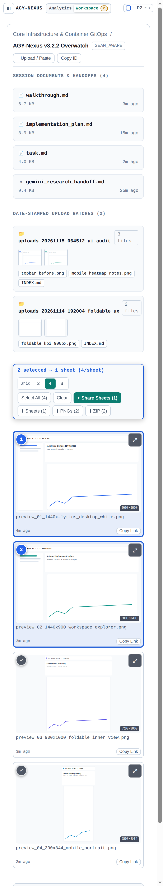

# `agy-nexus-mcp` — Connect Google Gemini to Your Antigravity IDE, 2-Pane Workspace & Usage Studio (`v3.1.0`)

`agy-nexus-mcp` is a self-hosted **Dual-Doorway Model Context Protocol (MCP)** server that connects **Google Gemini** (on Web, Mobile, and Tasks) directly to your local **Google Antigravity IDE / CLI** workstation—paired with **`agy-praxis-mcp`** (a deadbolt-free, LAN-only semantic codebase index & `<repo-slug>-NN` handoff inbox for local Antigravity agents) and a **Unified `42px` Chromium Studio Web App (`/web`)** combining live **Analytics** and a **2-Pane Session Workspace Explorer**.

From your phone or browser, you can monitor running coding sessions, inspect a copy-ready **76-column Project $\rightarrow$ Chat $\rightarrow$ Session ID hierarchy**, browse session Markdown plans in an **Editorial HTML Reader**, multi-select screenshots to **share directly back into Gemini** (via Web Share API, 1-click `<canvas>` Contact Sheet, or `.zip` bundle), stage repo-prefixed `<repo-slug>-NN` handoffs with **continuity-aware rollover & in-place session retirement**, or view **three-tier ASCII telemetry** directly in chat.

---

## Live `/web` Unified Studio App (`Analytics` + 2-Pane `Workspace`)

### 1. `Analytics` Surface — Muted `Mon–Sun` Calendar Matrix, Adaptive Sub-Daily Stacked Bars & Code Health


### 2. `Workspace` Surface — 2-Pane Session Explorer, Editorial Reader & Multi-Select Visual Gallery


<details>
<summary><strong>📱 View Responsive Mobile Layouts (<code>390px</code> Portrait — Analytics <code>26w</code> Matrix &amp; 1-Row Mobile Workspace Explorer)</strong></summary>

<br/>

#### Mobile `Analytics` (`26w` Auto-Default Calendar Matrix & `2×2` Foldable KPIs)


<br/>

#### Mobile `Workspace` (1-Row `40px` Header, Session Bucket & Multi-Select Gallery)



</details>

---

## Best Features & Advantages (`v3.1.0`)

### 1. Dual-Doorway Parallel Isolation, `<repo-slug>-NN` Handoff Queue & Fail-Closed Routing
- **Parallel Session Isolation & Keyed Context Slots**: Multiple Gemini Web and Gemini Mobile tabs work concurrently across different repositories and conversations without overwriting each other's active workspace (`session_identifier` and `workspace` pinning backed by `fcntl.flock` atomic state slots).
- **`agy-praxis-mcp` Local IDE Doorway (`6` Tools)**: Exposes incremental SHA-256 Polyglot semantic indexing (`polyglot_map`, `polyglot_search`, `polyglot_outline` across 10+ languages) **plus** the repo-prefixed Gemini handoff queue (`praxis_handoff_inbox`, `praxis_claim_handoff`, `praxis_update_handoff`) at `/praxis/{PRAXIS_MCP_TOKEN}/mcp` (and legacy `/polyglot/` alias or `--stdio`) with zero deadbolt friction and strict LAN-only `403` proxy/Origin rejection.
- **3-Pillar Fail-Closed Target Resolution (`target_resolver.py`)**: Resolves repositories across `projects/`, `devops/`, and `lab/` (`~/projects/<slug>` aliases supported), blocking silent fallback to umbrella roots with `status="PROJECT_NOT_FOUND"` unless `create_new_project=True` is explicitly approved.
- **Repo-Prefixed Handoff Lifecycle (`handoff_queue.py`)**: Assigns sequential human-readable IDs (`agy-nexus-mcp-01`, `quiet-ui-skills-02`, ...) tracked atomically across `STAGED` $\rightarrow$ `IN_WORK` $\rightarrow$ `COMPLETED` / `SUPERSEDED`, with automatic disambiguation when multiple tickets are queued.
- **Same-Repo Concurrent Writer Guard**: Detects when another Antigravity session is actively `RUNNING` on the same repository, labeling sessions as `MAIN WRITER`, `WORKTREE`, `SHARED (READ-ONLY)`, or `MAIN TREE` and recommending `use_worktree=True` before dispatching concurrent edits.

### 2. Built for Reliability on Gemini Web & Mobile (`v2.9.0` – `v3.1.0`)
- **Sequential Read-Only Governance (`v2.9.0`)**: Gemini can execute up to **4 sequential (one-at-a-time, never parallel) read-only MCP calls** in a single user turn (e.g., `unlock_sessions` $\rightarrow$ `list_saved_sessions` $\rightarrow$ `load_session_into_gemini` $\rightarrow$ `ask_workspace_readonly`), while keeping mutating `send_handoff_and_resume` and `LOCKED_RESPONSE` strictly terminal so mobile/web confirmation cards never hang.
- **Continuity-Aware Rollover (`v3.0.0`) & In-Place Terminal Closeout (`v3.1.0`)**:
  - Classifies session context pressure into 5 tiers (`FRESH`, `SEAM_AWARE`, `HOLD_FOR_COMPLETION`, `CLOSEOUT_ONLY`, `HARD_ROLLOVER`) instead of forcing premature new-chat splits mid-verification.
  - Supports **in-place closeout & retirement** (`session_continuity="closeout"`, `retire_session=True`), allowing mature sessions (`320–520` steps) to commit, push, clean up worktrees, and write an atomic `RETIRED.json` tombstone (`[■ RETIRED]`) in the **same** session without wasting tokens booting a new chat.
  - **Job-First 1-Tap `"Yes"` Flow**: Every session load, handoff, and background poll returns concrete `suggested_actions` (`ready_to_run`, `in_flight`, `ready_to_ship`) so Gemini always prioritizes finishing active work before offering closeout, and a single `"Yes"` reply executes cleanly.
- **7-Day HMAC-Signed `/web/media/` Links & Canonical `workspace_url` Deep Links**: Serves crisp adaptive WebP previews (`< 20 KB` wire budget) alongside 7-day (`604,800s`) HMAC-SHA256 signed `/web/media/` asset URLs (`GET` + `HEAD`) and signed `/web?s=...#workspace` deep links.
- **Voice-Friendly Passphrase Deadbolt**: Protected by an unguessable URL path (`/{PATH_SECRET}/mcp`) plus an interactive passphrase deadbolt (`unlock_sessions`) that strips punctuation and voice filler (*"The passphrase is ..."*) for hands-free Gemini Live / Mobile Voice unlock.

### 3. Unified `42px` Chromium Studio App (`/web` PWA): `Analytics` + 2-Pane `Workspace`
- **Single-Tier `42px` Studio Shell & Settings (`⚙`) Popover**: Clean `[■ AGY-NEXUS • v3.1.0]` topbar with `Analytics | Workspace` surface switcher (and live staged-handoff count pill), foldable KPI strip (`▾`/`▸`), clean pre-unlock header, 1-row `40px` mobile Workspace bar, and a consolidated `⚙` popover housing **4 Themes** (`Obsidian`, `Dark Paper`, `Warm Paper`, `Pure White`), **4 Densities** (`D1`–`D4`), and **1-click Chromium Standalone PWA installation**.
- **`Analytics` Surface**: Single-hue (`#2563eb`) 52w/26w `Mon–Sun` calendar heatmap with muted out-of-window cells (auto-defaulting to `26w` on narrow phones), adaptive sub-daily (`1h`–`24h`) stacked bar charts with borderless tabular legends, 1-line project swatch strip, 8-char Session ID pills, and 36-module Code Health table.
- **`Workspace` Surface & Multi-Select Visual Gallery**:
  - **3-State Collapsible Finder Tree**: Toggle between `240px` Expanded Tree, `38px` Icon Rail, and `0px` Zen Canvas (`◧` button or `[` shortcut) across the **Visual Handoffs Queue** and every project/session.
  - **Quiet UI Editorial HTML Reader (`markdown_renderer.js`)**: Renders `task.md`, `implementation_plan.md`, `walkthrough.md`, and staged handoffs into clean, XSS-sanitized Editorial HTML with sticky TOC, GFM callouts, checklists, and Raw Markdown toggle.
  - **Multi-Select Gallery (`gallery_select.js`)**: Select screenshots via click, `Shift+Click` range, or rubber-band marquee drag to reveal the sticky **Bulk Action Bar**—featuring **Web Share API Level 2 (`✦ Share to Gemini`)**, **1-Click `<canvas>` Contact Sheet (`Copy Sheet for Chat`)**, **Streaming `.zip` Download (`↓ ZIP`)**, and sequential PNG saves.

---

## How to Set It Up & Use It

### Step 1: Run the Setup Script & Self-Tests
Clone the repository on your workstation and run the interactive setup script to generate your passphrase hash, `PATH_SECRET`, `PRAXIS_MCP_TOKEN`, and `HOST_BRIDGE_TOKEN`:

```bash
# Linux / macOS / WSL
./scripts/setup.sh

# Windows PowerShell
.\scripts\setup.ps1
```

Or initialize secrets, run the automated test suites, and start the server directly:

```bash
python3 scripts/init_secrets.py --passphrase "your-secret-passphrase"
python3 ag_bridge.py --self-test
python3 -m agy_nexus.tools_praxis --self-test
pytest
python3 ag_bridge.py
```

*(See [docs/DEPLOYMENT.md](docs/DEPLOYMENT.md) for hardened Docker Compose, reverse proxy, Cloudflare Tunnel, 3-pillar workspace mounts, and 3-2-1 backup setup.)*

### Step 2: Connect Google Gemini & Local Antigravity IDE
1. **Google Gemini (Web / Mobile / Tasks)**: Open **Settings** $\rightarrow$ **Connected Apps** $\rightarrow$ **Add custom MCP server** and paste your secret endpoint URL:
   `https://<your-subdomain>.<your-domain>/{PATH_SECRET}/mcp`
2. **Local Antigravity IDE (`agy-praxis-mcp`)**: Add the LAN-only Praxis server to `~/.gemini/config/mcp_config.json` for zero-deadbolt incremental semantic indexing and `<repo-slug>-NN` handoff claiming (`/polyglot/<TOKEN>/mcp` also remains active as a backward-compatible alias):
   ```json
   {
     "mcpServers": {
       "agy-praxis-mcp": {
         "serverUrl": "http://<host>.lan:8765/praxis/<PRAXIS_MCP_TOKEN>/mcp"
       }
     }
   }
   ```
3. **Unified Studio Web App (`/web`)**: Open your dashboard in any desktop or mobile browser (and click **`⚙` $\rightarrow$ Install App** for a standalone window):
   `https://<your-dashboard-host>/web` *(or preview depersonalized demo mode locally at `http://127.0.0.1:8765/web?demo=1`)*

### Step 3: Everyday Prompts You Can Use in Gemini
Once connected, talk or type naturally in Gemini Web or Gemini Mobile:
- **Unlock & inspect active work in one turn**: *"Unlock Antigravity with passphrase [your phrase], check my active sessions, and load `agy-nexus-mcp`."*
- **View the Project & Session ID Tree**: *"Show me my session tree so I can see open `<repo>-NN` handoffs and copy session IDs."*
- **Search & read code across parallel tabs**: *"Search `automation-gitops` for compose healthcheck rules and read the matching spans."*
- **Stage or wake a `<repo-slug>-NN` handoff**: *"Stage this surgical audit plan to `quantum-dsp-workbench` with `allow_chained_publish=False` and wake it up."*
- **Close out & retire a finished session in place**: *"Commit, push, and retire session `agy-nexus-mcp` in place now that verification passed."*
- **View ASCII telemetry in chat**: *"Show me my latest usage stats"* (or ask for `quick` 40-col mobile view or `rich` 76-col widescreen view).

---

## Project Manager Mode with Gemini High Task & Job-First Lifecycle (`v3.1.0`)

`agy-nexus-mcp` turns **Google Gemini High Task Mode** into an autonomous, grounded **Engineering Project Manager** for your Antigravity IDE workstation:

1. **Sequential Read-Only Grounding (`<= 4` Hops/Turn)**: Gemini scouts live session state, cached Polyglot outlines, and git diffs sequentially in a single user turn before proposing changes.
2. **Stage & Preview Gate (`allow_chained_publish=False`)**: Research handoffs stage `<repo-slug>-NN` tickets (`scratch/gemini_research_handoff.md`), wake Antigravity's 4-step subagent pipeline (`flash-scout` $\rightarrow$ `flash-surgeon`/`argon-surgeon` $\rightarrow$ `flash-auditor` $\rightarrow$ Visual Gate), and halt at local preview with 7-day signed `/web/media/` screenshots and a clickable `workspace_url`.
3. **Job-First 1-Tap `"Yes"` Progression**:
   - **`ready_to_run`** (staged unclaimed handoff waiting): Prompts to execute `<repo-slug>-NN` before anything else.
   - **`in_flight`** (background agent running): Prompts to inspect live progress or tail logs without interrupting.
   - **`ready_to_ship`** (all tasks verified & clean): Offers 1-tap **in-place closeout & retirement** (`session_continuity="closeout"`, `retire_session=True`, `allow_chained_publish=True`), writing `RETIRED.json` so retired sessions cannot be accidentally mutated later (`[RETIRED_SESSION_GUARD]`).

### The 3 Interaction Modes (`handoff_mode`)

| Mode | Argument | Purpose & Behavior | Antigravity Subagent Execution |
| :--- | :--- | :--- | :--- |
| **Iterative Intent Briefs** | `handoff_mode="intent"` *(Default)* | Pass clean user requirements, UX flows, and acceptance criteria **without** guessing unverified code or CSS from memory. | `flash-scout` maps the repo via `agy-praxis-mcp`; `flash-surgeon` / `argon-surgeon` and `flash-auditor` write and verify the code. |
| **Visual & Artifact Critiques** | `handoff_mode="visual_critique"` | Translate `/web` gallery contact sheets and screenshots into grounded visual deltas. | Anchors critiques directly to component spans and `quiet-ui` visual contracts. |
| **Grounded Surgical Audits** | `handoff_mode="surgical_audit"` | Provide exact line-level code or architecture fixes **only after** reading target files via read-only tools. | Performs surgical refactors (`<= 500L` target, `650L` ceiling) followed by `pytest` & independent auditor sign-off. |

---

## Copy-Ready 76-Column Project, Chat & Session Hierarchy (`get_session_tree`)

Call `get_session_tree()` (or `manage_background_run(action="sessions")`) to render a copy-ready 76-column ASCII hierarchy grouping every conversation and staged `<repo-slug>-NN` handoff under its parent project with **untruncated** `project_id`, `session_id`, and `workspace` lines:

```text
╔══════════════════════════════════════════════════════════════════════════╗
║ AGY-NEXUS // PROJECT -> CHAT -> SESSION ID HIERARCHY (COPY-READY)        ║
╠══════════════════════════════════════════════════════════════════════════╣
║ ACTIVE SLOTS: 4 | PINNED: 18 | STAGED HANDOFFS: 2 | TTL: 119.5m          ║
║ 3-2-1 BACKUP: 74b696b (SYNCED ✓ · 2418.4 KB · 14m ago)                   ║
╚══════════════════════════════════════════════════════════════════════════╝

[PROJECT 1] Core Infrastructure & Container GitOps
  project_id : 491f269e-6a46-6930-b114-8a596add625a
  workspaces : /home/dev/agentic_workspace/projects/agy-nexus-mcp, /home/dev/agentic_workspace/devops/container-gitops
  ├─ [HANDOFF agy-nexus-mcp-02] STAGED · surgical_audit · 4m ago
  ├─ [#1] AGY-Nexus MCP v3.1.0 Unified Studio Shell
  │   session_id : 031d6672-9375-a94d-ee14-21e19d067ef5
  │   workspace  : /home/dev/agentic_workspace/projects/agy-nexus-mcp
  │   status     : [● RUNNING] · MAIN WRITER · SEAM_AWARE · 284 steps · 1m ago
  └─ [#9] Release v3.0.0 Telemetry Closeout
      session_id : 71bf3617-da78-cfad-ec6f-3034f1b76421
      workspace  : /home/dev/agentic_workspace/projects/agy-nexus-mcp
      status     : [■ RETIRED] · MAIN TREE · 412 steps · 2d ago

[PROJECT 2] quantum-dsp-workbench [SHARED REPO]
  project_id : e1676a6d-c5ba-1829-f129-86a6cea0e5bd
  workspaces : /home/dev/agentic_workspace/projects/quantum-dsp-workbench
  ├─ [HANDOFF quantum-dsp-workbench-01] IN_WORK -> b5e74c3c · 12m ago
  ├─ [#3] [QDSP-Portal] Landing Page & Platform Shell
  │   session_id : b5e74c3c-15dd-1552-8f4a-5ff63090b4db
  │   workspace  : /home/dev/agentic_workspace/projects/quantum-dsp-workbench
  │   status     : [◉ PINNED · IDLE] · MAIN TREE · FRESH · 194 steps · 18m ago
  └─ [#4] [QDSP-Learn-RF] RF & DSP Data Communications
      session_id : 859dbded-76ce-bd86-861c-8397545e55c8
      workspace  : /home/dev/agentic_workspace/projects/quantum-dsp-workbench
      status     : [○ IDLE] · WORKTREE · 318 steps · 3h ago
```

---

## Three-Tier ASCII Usage Reports in Chat

Ask Gemini for your usage stats (`get_session_tree(include_stats=True, period="last_90d", style=...)` or `manage_background_run(action="stats", ...)`) to render live Dual-Pool quota pacing, `Mon–Sun` calendar heatmaps, sub-daily curves, and workspace/subagent token breakdowns in **three plain-text layouts**:

| Style | Width | Best For | What It Shows |
| :--- | :---: | :--- | :--- |
| **`style="default"`** | **72 cols** | Standard Desktop & Tablet Chat | Split summary header, 22-week `Mon–Sun` heatmap, 8-hour activity & project stack (`░▒▓█`), model quota bars (`┼`), Praxis/Polyglot health, and project & subagent tables. |
| **`style="quick"`** | **`<= 40` cols** | Phone Screens (Portrait) | Fits strictly within 40 characters per line so it never wraps on mobile. Shows a 13-week heatmap, 8-hour pace curve, model quota bars, and top projects/subagents. |
| **`style="rich"`** | **76 cols** | Widescreen Desktop Chat | Full box-drawn rig (`v3.1.0`) with side-by-side quota and token panels, 13-week 3-character heatmap with Peak Day card, 6-row 8-hour curve, and share gauges. |

### 1. `style="default"` (72-Column Standard Layout)

```text
════════════════════════════════════════╤═══════════════════════════════
AGY-NEXUS // 90d (Nov 15 ◄── Aug 18)    ┆ EXTENDED TELEMETRY & AVERAGES 
════════════════════════════════════════╪═══════════════════════════════
GOOGLE 20x : 100.0% [████████┼█] HEALTHY┆ 0x 429s | Ultra-20x (T:>=90%) 
PARTNER 1x : 100.0% [░┼░░░░░░░░] ON PACE┆ 14.3% Wk Left | Lim <=14.3%/d 
STEPS/TOOLS: 208,496s | 103,976t | 65c  ┆ 4,436 s/act-d | 2,316 s/cal-d 
TOKEN BURN : ~77.4M Total (227 sub runs)┆ 1.65M tok/d   | 11.5M tok/wk  
MCP WIRE   : 96% <20KB (avg 9.3/33.7KB) ┆ 200 req (514k tok) | Gemini We
────────────────────────────────────────┴───────────────────────────────
DAILY HEATMAP (NOW: W01 ──► 22w AGO)   Peak: 10/31 (10,964s) | Act: 47d
Wk    01 02 03 04 05 06 07 08 09 10 11 12 13 14 15 16 17 18 19 20 21 22
Mon   ▒▒ ██ ░░ ▒▒ ▓▓ ▒▒ ·· ·· ·· ·· ·· ·· ·· ·· ·· ·· ·· ·· ·· ·· ·· ··
Tue   ▒▒ ▓▓ ▒▒ ▒▒ ▒▒ ░░ ░░ ·· ·· ·· ·· ·· ·· ·· ·· ·· ·· ·· ·· ·· ·· ··
Wed   ▓▓ ██ ░░ ░░ ▒▒ ▓▓ ░░ ·· ·· ·· ·· ·· ·· ·· ·· ·· ·· ·· ·· ·· ·· ··
Thu   ░░ ▓▓ ░░ ▒▒ ▓▓ ██ ░░ ·· ·· ·· ·· ·· ·· ·· ·· ·· ·· ·· ·· ·· ·· ··
Fri   ▓▓ ▓▓ ██ ▒▒ ░░ ██ ██ ·· ·· ·· ·· ·· ·· ·· ·· ·· ·· ·· ·· ·· ·· ··
Sat   ▓▓ ██ ██ ░░ ▒▒ ██ ██ ·· ·· ·· ·· ·· ·· ·· ·· ·· ·· ·· ·· ·· ·· ··
Sun   ·· ▓▓ ██ ▓▓ ▓▓ ██ ▒▒ ·· ·· ·· ·· ·· ·· ·· ·· ·· ·· ·· ·· ·· ·· ··
Vol   ▄▄ ██ ▆▆ ▃▃ ▄▄ ▆▆ ▃▃ ── ── ── ── ── ── ── ── ── ── ── ── ── ── ──
────────────────────────────────────────────────────────────────────────
8H SUB-DAILY PACE (NOW ──► SEP 29)   [Avg: 1.6k/8h | Peak: 4.5k | ░▒▓█]
4.5k ╷                 ▄█ █                                            
2.4k ┤█                █████  ▄                     ██  ▄      ▄▄      
1.6k ┼██▄─────▄██─█▄──██████──█──────█───█─▄█──█─▄──██─██▄▄──▄─██──────
   0 ╵░▓▓ ▓▓▓▄█▒▓▓█▒▓▄███▒▒▒  ▒▄ ▒▄▄▄██▄ █▄██ ██▄██ ████▓▓▓ ▓▓▄▓▓▓▄  ▄ 
     └─▲────────────▲────────────▲────────────▲────────────▲──────────▲─
      Nov 15       Nov 05       Oct 26       Oct 16       Oct 07     Sep
      Stack: [█] nexus-mesh-te (36%)  [▓] automation-gi (28%)  [▒] chron
────────────────────────────────────────────────────────────────────────
MODEL QUOTA vs TARGET (┼ = Target Pin)      CALLS   EST TOK  DELTA  STAT
Carbon 4    [██████████░░┼░░░░░░░]  54.2%   54,240    ~14.1M  +4.2%  OK
Argon 4 Pro [█████▓░░┼░░░░░░░░░░░]  29.1%   29,141     ~7.2M  -0.9%  OK
Flash 3.8   [███▓░┼░░░░░░░░░░░░░░]  16.7%   16,707     ~3.7M  -3.3%  OK
Claude 5.5  [░░┼░░░░░░░░░░░░░░░░░]   0.0%       12     ~4.1k  -8.0%  OK
────────────────────────────────────────────────────────────────────────
WORKSPACES (8)      CHATS   STEPS   TOTAL TOK  TOK/DAY   TOK/WK   SHARE
1. nexus-mesh-telem  10c  75,084     ~29.2M     621k    4.35M   36.0%
2. automation-gitop  19c  57,456     ~18.7M     398k    2.79M   27.6%
3. chronos-board      5c  40,110     ~16.5M     351k    2.46M   19.2%
4. quantum-dsp-work  11c  10,298      ~3.7M      78k     548k    4.9%
5. agy-nexus-mcp      6c   8,412      ~3.1M      66k     462k    4.1%
────────────────────────────────────────────────────────────────────────
SUBAGENTS (6)        RUNS   STEPS   TOTAL TOK  TOK/DAY   TOK/WK   SHARE
1. flash-surgeon    116r  21,746      ~8.9M     190k    1.33M   51.0%
2. flash-auditor     78r   9,112      ~3.0M      64k     450k   21.4%
3. argon-sentinel     3r   4,537      ~1.9M      41k     285k   10.6%
4. argon-surgeon      2r   3,170      ~1.3M      28k     196k    7.4%
5. flash-scout       20r   3,012      ~1.1M      24k     170k    7.1%
════════════════════════════════════════════════════════════════════════
```

### 2. `style="quick"` (40-Column Mobile Layout)

```text
════════════════════════════════════════
AGY-NEXUS // 90d (Nov 15 ◄── Aug 18)
════════════════════════════════════════
G-20x: 100% [████████┼█] OK | 0x 429s
P-1x : 100% [░┼░░░░░░░░] OK | 14% WkLft
Steps:208.5k | Tools:104.0k | Act:47d
Burns:~77.4M | 1.65M/d | 11.5M/wk
────────────────────────────────────────
HEATMAP (NOW ──► 13w Ago)  │ PEAK & VOL
Mo ▒█░▒▓▒·······           │ Pk: 10/31
Tu ▒▓▒▒▒░░······           │ 10,964 stp
We ▓█░░▒▓░······           │ Avg:4,436/d
Th ░▓░▒▓█░······           │ Chats: 65c
Fr ▓▓█▒░██······           │ Subs : 227r
Sa ▓██░▒██······           │ Tok/d:1.65M
Su ·▓█▓▓█▒······           │ Tok/w:11.5M
────────────────────────────────────────
MODEL QUOTA (┼=Target)  PCT   TOK   DLT
Carbon4 [█████┼░░░░]  54% 14.1M   +4%
Argon 4 [███┼░░░░░░]  29%  7.2M   -1%
Flash38 [██┼░░░░░░░]  17%  3.7M   -3%
Claude5 [░┼░░░░░░░░]   0%  4.1k   -8%
════════════════════════════════════════
```

### 3. `style="rich"` (76-Column Widescreen Layout)

```text
╔══════════════════════════════════════════════════════════════════════════╗
║ ▄▀█ █▀▀ █▄█ ▄▄ █▄░█ █▀▀ ▀▄▀ █░█ █▀   v3.1.0 // RICH TELEMETRY RIG        ║
║ █▀█ █▄█ ░█░ ░░ █░▀█ ██▄ █░█ █▄█ ▄█   WINDOW: 90d (Nov 15 ◄── Aug 18)     ║
╠════════════════════════════════════╦═════════════════════════════════════╣
║ QUOTA POOLS & 429 COOLDOWNS        │ STEP & TOOL VELOCITY                ║
║ G-20x: 100.0% [████████┼█] OK      │ Total : 208,496 steps | 103,976 too ║
║ P-1x : 100.0% [░┼░░░░░░░░] OK      │ Active: 4,436 s/act-d (47d active)  ║
║ 429s : 0 events | 14.3% Wk Left    │ Calend: 2,316 s/cal-d (65c, 227r)   ║
╠════════════════════════════════════╬═════════════════════════════════════╣
║ TOKEN BURN & ROLLING AVERAGES      │ MCP WIRE & CLIENT SURFACES          ║
║ Total : ~77.4M (~70.4M direct)     │ Wire  : 96% <20KB (avg 9.3/33.7KB)  ║
║ Daily : 1.65M tok/act-d            │ Calls : 200 MCP reqs (514k tok)     ║
║ Weekly: 11.5M tok/wk               │ Client: Gemini Web (84% / 16% Mob)  ║
╠════════════════════════════════════╩═════════════════════════════════════╣
║ DAILY ACTIVITY MATRIX (NOW: W01 ──► W13)     [·· 0  ░░ <1k  ▒▒ <4k  ██]  ║
║ Wk   W01 W02 W03 W04 W05 W06 W07 W08 W09 W10 W11 W12 W13  ┌─ PEAK DAY ─┐ ║
║ Mon  ▒▒▒ ███ ░░░ ▒▒▒ ▓▓▓ ▒▒▒ ··· ··· ··· ··· ··· ··· ···  │ Oct 31     │ ║
║ Tue  ▒▒▒ ▓▓▓ ▒▒▒ ▒▒▒ ▒▒▒ ░░░ ░░░ ··· ··· ··· ··· ··· ···  │ 10,964 stp │ ║
║ Wed  ▓▓▓ ███ ░░░ ░░░ ▒▒▒ ▓▓▓ ░░░ ··· ··· ··· ··· ··· ···  ├────────────┤ ║
║ Thu  ░░░ ▓▓▓ ░░░ ▒▒▒ ▓▓▓ ███ ░░░ ··· ··· ··· ··· ··· ···  │ Act: 47d   │ ║
║ Fri  ▓▓▓ ▓▓▓ ███ ▒▒▒ ░░░ ███ ███ ··· ··· ··· ··· ··· ···  │ Avg:  4.4k │ ║
║ Sat  ▓▓▓ ███ ███ ░░░ ▒▒▒ ███ ███ ··· ··· ··· ··· ··· ···  │ Sub: 227r  │ ║
║ Sun  ··· ▓▓▓ ███ ▓▓▓ ▓▓▓ ███ ▒▒▒ ··· ··· ··· ··· ··· ···  └────────────┘ ║
╚══════════════════════════════════════════════════════════════════════════╝
```

---

## Advanced Workflows: Gemini Notebook, Scheduled Gemini Tasks & Split-Trust

1. **Zero-Token Reference Lookup with Gemini Notebook**: Store large hardware manuals, RFCs, or API specs in Gemini Notebook, extract exact cited excerpts in Gemini, and dispatch a concise brief via `send_handoff_and_resume` so local agents start coding immediately without burning local context scanning PDFs.
2. **Searchable Project Memory (`export_notebook` with `dry_run` Preview)**: Export completed session plans and walkthroughs into SHA-256 deduplicated Markdown files (`YYYY-MM-DD_<repo>_<title>_<id>.md`) via `manage_background_run(action="export_notebook")` (pass `dry_run=True` first to preview pending exports).
3. **Scheduled Gemini Tasks & Split-Trust Lock Options**:
   - **`AG_BRIDGE_ALLOW_LOCKED_STATS=true`**: Allows `get_session_tree(include_stats=True)` and `manage_background_run(action="stats")` to return policy-safe usage/quota summaries while locked without exposing code, paths, or chat messages.
   - **`AG_BRIDGE_ALLOW_LOCKED_STAGING=true`**: Allows `send_handoff_and_resume(..., resume_headless=False)` while locked to stage incoming notes into `sidecar_data/ag-bridge-bg/quarantine_handoffs/`.
   - **Single-Turn Multi-Repo Drift Audits**: Call `inspect_git_diff(workspace_override="ALL")` to audit uncommitted changes across every repository in one turn.
4. **Virtual URI Dispatcher (`virtual_uris.py`)**: Read untruncated conversation turns (`transcript:<conv_id>:turn:latest`), nested session artifacts (`brain:<conv_id>/scratch/...`), Praxis/Polyglot maps (`praxis:map`, `praxis:handoffs`, `polyglot:search:<q>`), and policy-safe telemetry (`telemetry:stats`) directly via `ask_workspace_readonly`.

---

## Available MCP Tools (`17` Total Across Dual Doorways)

### 1. `agy-nexus-mcp` Remote & Mobile Bridge Surface (`11` Tools)

| Tool | What It Does |
| :--- | :--- |
| `unlock_sessions(spoken_passphrase, search_query="")` | Verifies your voice/text passphrase, unlocks the sliding-TTL deadbolt, and returns numbered recent sessions (`1..N`) plus live usage telemetry. |
| `lock_bridge()` | Immediately engages the deadbolt and clears unlocked session state. |
| `list_saved_sessions(limit, status_filter, include_subagents)` | Lists recent Antigravity chats with live status (`RUNNING`, `STALLED_WAITING_APPROVAL`, `COMPLETED`, `IDLE`, `RETIRED`), continuity tier, project path, and summary. |
| `load_session_into_gemini(session_identifier, include_files)` | Loads a chat by `#N`, `<repo-slug>-NN`, UUID prefix, or title keyword—returning `task.md`, `implementation_plan.md`, `walkthrough.md`, git status, 7-day signed `visual_artifacts`, `workspace_url`, continuity tier, and job-first `suggested_actions`. |
| `get_session_tree(active_only, project_filter, limit, include_stats, period, style)` | Renders the copy-ready 76-column ASCII `Project -> Chat -> Session ID` + `[HANDOFF <slug>-NN]` hierarchy, 3-2-1 backup status, and optional `include_stats=True` three-tier ASCII telemetry. |
| `ask_workspace_readonly(question, search_query, file_subpath, start_line, end_line, session_identifier, workspace)` | Searches code (bounded multi-repo `git grep` + live `transcript_full.jsonl`/`brain/` search) or reads up to 12 files with line slicing, Virtual URIs (`transcript:`, `brain:`, `praxis:`, `telemetry:`), and cached Polyglot outlines. |
| `inspect_git_diff(target_branch, include_untracked, workspace_override, file_path, offset_chars, start_line, end_line, session_identifier, workspace)` | Inspects current branch, status, and paginated git diff for a repository—or pass `workspace_override="ALL"` to audit drift across all repositories in one call. |
| `inspect_visual_artifacts(session_identifier, artifact_filter, max_images, include_binary)` | Encodes crisp adaptive WebP previews (`< 20 KB` wire budget) alongside 7-day HMAC-SHA256 signed `/web/media/` links and canonical `/web#workspace` deep links. |
| `send_handoff_and_resume(research_markdown, resume_headless, execution_mode, session_identifier, workspace_path, project_name, create_new_project, session_continuity, retire_session, retirement_summary, ...)` | Stages repo-prefixed `<slug>-NN` handoffs, enforces fail-closed `PROJECT_NOT_FOUND` & `[RETIRED_SESSION_GUARD]` checks, handles `RESUME_STAGED`, continuity-aware rollover, in-place closeout/retirement (`RETIRED.json`), and wakes Antigravity. |
| `manage_background_run(action, job_id, tail_lines, period, style, dry_run)` | Monitors background jobs (`status`, `tail`, `stop`), renders `sessions` or 3-tier `stats`, or exports SHA-256 deduplicated plans/walkthroughs (`export_notebook` with `dry_run` preview). |
| `list_models_and_agents(include_skills, include_rules, skill_scope_filter, inspect_name)` | Lists configured Agent Roles, Skills, Rules, and Dual-Pool quota settings, or reads a specific skill/rule contract via `inspect_name`. |

### 2. `agy-praxis-mcp` Local Antigravity IDE Surface (`6` Tools — LAN-Only / `--stdio`)

| Tool | What It Does |
| :--- | :--- |
| `polyglot_map(workspace="", path_prefix="", limit=120, force_refresh=False)` | Builds or incrementally refreshes the SHA-256 Polyglot index for a workspace and returns its semantic file map, line counts, and top symbol spans. |
| `polyglot_search(query, workspace="", kind="", limit=25, force_refresh=False)` | Searches indexed functions, classes, methods, headings, JSON/YAML keys, CSS rules, and 1-liner docstrings with exact `Lstart-Lend` slice hints. |
| `polyglot_outline(file_subpath, workspace="", include_callers=False)` | Returns the complete `Lstart-Lend` structural outline, signatures, `>100L` function warnings, and 1-liner docstrings for a single file. |
| `praxis_handoff_inbox(workspace="", status_filter="ALL", include_superseded=True, limit=25)` | Lists repo-prefixed Gemini handoffs (`<repo-slug>-01`, `<repo-slug>-02`, ...) across `STAGED`, `IN_WORK`, `SUPERSEDED`, and `COMPLETED` states. |
| `praxis_claim_handoff(handoff_id="", workspace="", conversation_id="", force=False)` | Atomically claims a staged `<repo-slug>-NN` ticket for IDE execution (`STAGED` $\rightarrow$ `IN_WORK`), returning unwrapped `specification_markdown` (or disambiguating candidates). |
| `praxis_update_handoff(handoff_id, status="COMPLETED", conversation_id="", notes="")` | Updates a handoff ticket's lifecycle state (`COMPLETED`, `IN_WORK`, `STAGED`, or `SUPERSEDED`). |

---

## Comparison with Typical Antigravity Bridges

| Feature | Typical Community Bridges (`agy-bridge`, `meridian`, `ag-local-bridge`) | `agy-nexus-mcp` (`v3.1.0`) |
| :--- | :--- | :--- |
| **Connection Architecture** | Local `stdio` pipe or single-chat Telegram/WhatsApp bot | **Dual-Doorway Streamable HTTP MCP** (`agy-nexus-mcp` for Gemini Web/Mobile/Tasks + LAN-only `agy-praxis-mcp` for local Antigravity IDE) |
| **Zero-Trust Security** | None or static chat-ID allowlist | **5-Layer Defense**: Secret URL Path + Voice/Text Deadbolt + LAN-Only Praxis Gate + Sandboxed ZIP/File Readers + HMAC Host Bridge |
| **Parallel Isolation & Routing** | Single active chat; parallel tabs overwrite state | **Keyed Context Slots (`active_contexts`) + Fail-Closed 3-Pillar Resolver + `<repo-slug>-NN` Atomic Queue + Writer Guard** |
| **Session Lifecycle & Closeout** | Blind context overflows or manual chat juggling | **Continuity-Aware Rollover (`v3.0.0`) + In-Place Closeout & `RETIRED.json` Tombstones (`v3.1.0`) + Job-First 1-Tap `"Yes"` Flow** |
| **Web Studio & Workspace App** | None | **Unified `42px` Chromium Studio PWA (`/web`)**: `Analytics` (52w/26w Heatmap & Stacked Bars) + **2-Pane `Workspace`** (Editorial Reader & Multi-Select Gallery) |
| **Visual Artifact Round-Trip** | None | **7-Day HMAC-SHA256 Signed `/web/media/` Links + Web Share API v2 + 1-Click `<canvas>` Contact Sheet + Streaming `.zip` Export** |
| **Chat ASCII Telemetry** | None | **Policy-Safe Three-Tier Monospace ASCII** (`default` 72-col, `quick` 40-col mobile, `rich` 76-col desktop) + **76-Col Session Tree** |

---

## Bundled 8-Agent Orthogonal Roster (`agents/`)

`agy-nexus-mcp` ships with ready-to-use subagent definitions in [`agents/`](agents/) (`flash-scout`, `argon-architect`, `flash-surgeon`, `argon-surgeon`, `flash-auditor`, `argon-sentinel`, `claude-specialist`, `claude-sentinel`).

```bash
mkdir -p ~/.gemini/config/agents
cp agents/*.md ~/.gemini/config/agents/
```

Subagent runs and token share automatically appear in the `/web` Analytics surface and ASCII reports. See [`AGENTS.md`](AGENTS.md) and [`agents/README.md`](agents/README.md) for full details.

---

## Repository Layout (`v3.1.0`)

```text
agy-nexus-mcp/
├── src/
│   └── agy_nexus/                    # 36 cohesive functional modules (<= 500L target, 650L ceiling)
│       ├── __init__.py               # Package metadata (v3.1.0)
│       ├── config.py                 # Secrets loader, SHA-256 deadbolt, PRAXIS_MCP_TOKEN & keyed slots
│       ├── hygiene.py                # <20 KB wire compaction, sensitive file filter & diff paginator
│       ├── polyglot_outline.py       # Multi-language semantic outliner (Py/JS/TS/Vue/Go/Rust/Sh/SQL/MD/JSON/YAML/HTML/CSS)
│       ├── polyglot_index.py         # Incremental (mtime_ns, size) + SHA-256 workspace symbol cache
│       ├── handoff_queue.py          # Atomic <repo-slug>-NN handoff queue (STAGED / IN_WORK / SUPERSEDED / COMPLETED)
│       ├── tools_praxis.py           # Deadbolt-free local agy-praxis-mcp FastMCP server (6 IDE tools & --stdio)
│       ├── tools_polyglot.py         # Backward-compatible polyglot_mcp re-export shim
│       ├── virtual_uris.py           # Virtual URI dispatcher (brain:, transcript:, praxis:, polyglot:, telemetry:)
│       ├── inventory.py              # Skills, Agent Roles, Rules, Plugins & 3-pillar workspace scanner
│       ├── telemetry_scanner.py      # Local-TZ transcript JSONL heatmap, surface & token attribution scanner
│       ├── ascii_default.py          # Tier 1 (72-col Default) & Tier 2 (40-col Quick) ASCII renderers
│       ├── ascii_rich.py             # Tier 3 (76-col Rich Widescreen) ASCII renderer
│       ├── session_tree.py           # 76-col ASCII Project -> Chat -> Session ID + [HANDOFF <slug>-NN] builder
│       ├── session_status.py         # 5-tier continuity budget, compaction tracking & in-flight mutex
│       ├── retirement.py             # Atomic RETIRED.json tombstones & [RETIRED_SESSION_GUARD] closeout helper
│       ├── code_health.py            # Cached GitHub release comparator & <=500L/650L modular hygiene scanner
│       ├── stats_series.py           # Adaptive 1h/2h/6h/24h stacked model, subagent & project series builder
│       ├── stats.py                  # Unified Dual-Pool telemetry bundle & 3-tier ASCII router
│       ├── workflows.py              # Multi-repo drift audit, dry_run Notebook export & quarantine staging
│       ├── media.py                  # 7-day HMAC-SHA256 /web/media/ & canonical workspace_url signer
│       ├── uploads.py                # Session scratch batch upload receiver & INDEX.md generator
│       ├── bucket_api.py             # 2-Pane Workspace Explorer JSON APIs, raw file reader & streaming .zip exporter
│       ├── web_routes.py             # Static /web PWA asset server (GET/HEAD), /web/media/ & API dispatcher
│       ├── webhook_proxy.py          # GitHub -> GitLab webhook proxy handler
│       ├── sessions.py               # Read-only SQLite session indexer & concurrent writer detector
│       ├── routing.py                # Authenticated Host Companion (:8098) RPC & <repo-slug>-NN resolver
│       ├── target_resolver.py        # Fail-closed 3-pillar workspace/project resolver & alias normalizer
│       ├── search.py                 # Bounded multi-repo git grep, transcript_full.jsonl & SQLite FTS5 search
│       ├── workspace.py              # 3-tier smart path resolver, git diff & background job monitor
│       ├── tools_session.py          # MCP tools: unlock_sessions, lock_bridge, list/load sessions & suggested_actions
│       ├── tools_workspace.py        # MCP tools: ask_workspace_readonly & inspect_git_diff
│       ├── tools_media.py            # MCP tool: inspect_visual_artifacts (adaptive WebP + 7-day signed links)
│       ├── tools_ops.py              # MCP tools: get_session_tree, list_models_and_agents, manage_background_run
│       ├── handoff.py                # MCP tool: send_handoff_and_resume, continuity rollover & in-place retirement
│       ├── middleware.py             # BridgeCompatMiddleware (405 MCP spec, LAN-only /praxis/ gate & lifespan)
│       └── server.py                 # Dual-MCP Starlette/Uvicorn builder, threadpool offload & --self-test suite
├── ag_bridge.py                      # Backward-compatible 51-line root entrypoint shim
├── web/
│   ├── index.html                    # Unified 42px Studio shell (Analytics + 2-Pane Workspace, v3.1.0)
│   ├── styles.css                    # 4 Themes × 4 Densities tokens, responsive topbar & Explorer styles
│   ├── palettes.js                   # Theme & series color palette definitions
│   ├── demo_data.js                  # 100% depersonalized ?demo=1 Analytics & Workspace preview dataset
│   ├── charts.js                     # Single-hue #2563eb Mon–Sun Heatmap & adaptive Stacked Bar SVGs
│   ├── hierarchy.js                  # Project, Chat, Handoff & 8-char Session ID pill renderer
│   ├── health.js                     # 36-module Code Health & Praxis/Polyglot hygiene table renderer
│   ├── uploads.js                    # Inline drag/drop/paste batch uploader controller
│   ├── markdown_renderer.js          # Sanitized Quiet UI Editorial HTML Reader, TOC & GFM callouts
│   ├── gallery_select.js             # Multi-Select Gallery, marquee drag, Web Share v2 & <canvas> Contact Sheet
│   ├── explorer.js                   # 2-Pane Workspace Explorer tree, sidebar states & session bucket loader
│   ├── app.js                        # Studio state, surface switcher, foldable KPIs & Settings PWA popover
│   ├── manifest.webmanifest          # Chromium Standalone Web App Manifest
│   ├── sw.js                         # Root-scoped network-first Service Worker
│   └── icon.svg / icon-192 / 512.png # Vector & RGBA PWA icons
├── agents/                           # Bundled 8-Agent Orthogonal Roster templates (*.md)
├── skills/agy-nexus-stats/SKILL.md   # Policy-safe skill for Sequential Governance, 3-tier ASCII & /web stats
├── docs/
│   ├── DEPLOYMENT.md                 # Hardened Docker Compose, reverse proxy, Praxis MCP & HTTPS PWA guide
│   └── assets/                       # High-DPI (2x) depersonalized documentation screenshots
│       ├── dashboard-desktop.png     # Desktop Analytics (1440px @ 2x)
│       ├── dashboard-mobile.png      # Mobile Analytics (390px @ 2x)
│       ├── workspace-desktop.png     # Desktop 2-Pane Workspace & Multi-Select Gallery (1440px @ 2x)
│       └── workspace-mobile.png      # Mobile Workspace & Multi-Select Gallery (390px @ 2x)
├── host_bridge/                      # Loopback-only authenticated host daemon (:8098), CreateProject & security
├── scripts/                          # setup.sh, setup.ps1, init_secrets.py, publish_to_github.py, backup_321_sync.py
├── systemd/                          # ag-bridge.service & agy-host-bridge.service unit templates
├── tests/                            # 7 automated pytest & end-to-end MCP regression suites (v2.6 – v3.1.0)
├── AGENTS.md                         # AI coding assistant & multi-agent architecture guide (v3.1.0)
├── CHANGELOG.md                      # Complete release history (v1.0.0 – v3.1.0)
├── CONTRIBUTING.md                   # Contribution, PWA parity & <=500L/650L modular hygiene guidelines
├── SECURITY.md                       # 5-Layer Zero-Trust Deadbolt, LAN-only Praxis & sandbox security policy
├── LICENSE / NOTICE                  # GNU Affero General Public License v3.0 (AGPL-3.0-or-later) & Section 7 terms
└── docker-compose.yml / pyproject.toml / requirements.txt
```

---

## License, Attribution & Security Integrity (`GNU AGPLv3`)

`agy-nexus-mcp` is free and open-source software licensed under the **GNU Affero General Public License v3.0 or later (`AGPL-3.0-or-later`)** — see [`LICENSE`](LICENSE) and [`NOTICE`](NOTICE) for full terms.

### What This Means in Plain Language
1. **Always Open & Share-Alike (Including Network / Hosted Use — AGPLv3 §13)**:
   - You are free to use, study, modify, and self-host `agy-nexus-mcp`.
   - If you distribute modified versions—or run a modified version as a hosted service or network-accessible MCP / `/web` server for others—you **must** make the complete corresponding source code publicly available under `AGPLv3`. Nobody can take this project private or wrap it into a proprietary commercial offering.
2. **Required Attribution & Brand Protection (AGPLv3 §7(b), §7(c) & §7(e))**:
   - All copies, forks, and derivative works must preserve the copyright notices, license notices, and upstream attribution in [`NOTICE`](NOTICE) and in the `/web` and ASCII telemetry interfaces.
   - Modified versions must be clearly marked as modified and **may not** be advertised or misrepresented as the official original `agy-nexus-mcp` release.
3. **Security-Integrity Disclosure (AGPLv3 §7(c) & §5(a))**:
   - The voice-passphrase deadbolt (`PASS_HASH`), unguessable `PATH_SECRET` routing, LAN-only `agy-praxis-mcp` isolation, path-traversal sandboxing, and read-only SQLite isolation are core security guarantees of `agy-nexus-mcp`.
   - Any fork or derivative work that weakens, bypasses, or strips these security controls **must** prominently disclose that its security boundary has been removed or altered and may not present itself under the unmodified `agy-nexus-mcp` / `AGY-NEXUS` identity.
