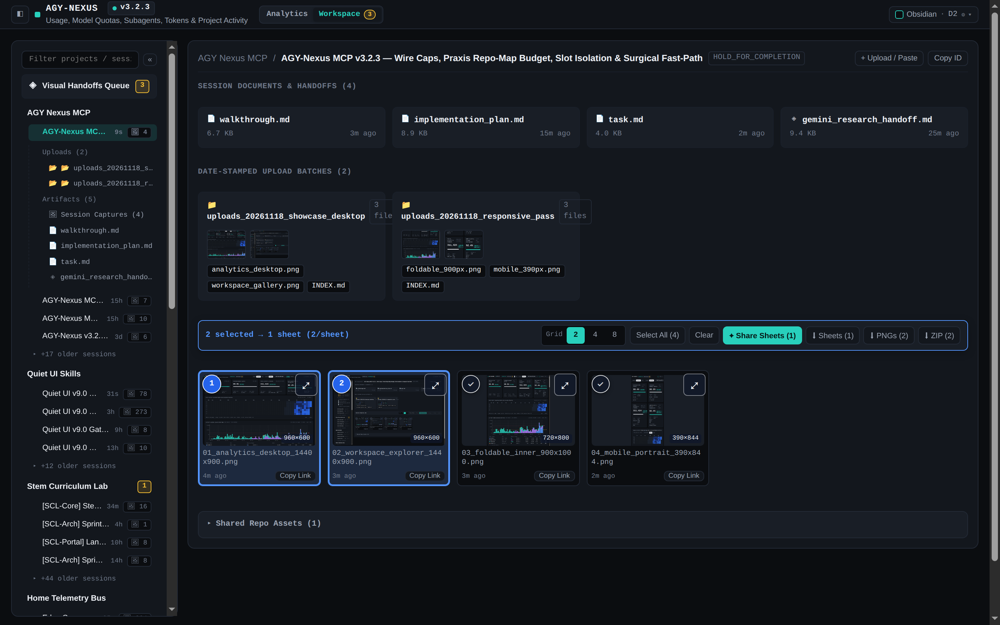

# `agy-nexus-mcp` — Connect Google Gemini to Your Antigravity IDE, 2-Pane Workspace & Usage Studio (`v3.2.4`)

`agy-nexus-mcp` is a self-hosted **Dual-Doorway Model Context Protocol (MCP)** server connecting **Google Gemini** (Web, Mobile & Tasks) directly to your local **Google Antigravity IDE / CLI** workstation—paired with **`agy-praxis-mcp`** (deadbolt-free LAN-only semantic codebase index & `<repo-slug>-NN` handoff inbox) and a **Unified `42px` Chromium Studio (`/web` PWA)** with live **Analytics** and a **2-Pane Session Workspace Explorer**.

---

## Live `/web` Unified Studio App (`Analytics` + 2-Pane `Workspace`)

### 1. `Analytics` — Muted `Mon–Sun` Calendar Matrix, Sub-Daily Stacked Bars & Code Health


### 2. `Workspace` — 2-Pane Session Explorer, Editorial Reader & Direct PNG / Sheet Gallery


<details>
<summary><strong>📱 Mobile Layouts (<code>390px</code> Portrait — Analytics <code>26w</code> Matrix &amp; 1-Row Workspace Explorer)</strong></summary>


</details>

---

## Key Capabilities (`v3.2.4`)

- **Dual-Doorway Parallel Isolation & `<repo-slug>-NN` Queue**: Concurrent Gemini Web/Mobile tabs work across separate repositories via `fcntl.flock` `active_contexts` slots (with automatic stale test-slot pruning), 3-pillar fail-closed resolution (`target_resolver.py`), same-repo concurrent writer detection (`MAIN WRITER` / `WORKTREE` / `SHARED`), and atomic `<slug>-NN` handoffs (`handoff_queue.py`) with proportional **Surgical Fast-Path** vs. Full Dual-Review execution (`handoff_templates.py`).
- **`agy-praxis-mcp` Local IDE Doorway (`6` Tools)**: Incremental SHA-256 Polyglot semantic indexing (`polyglot_map` strictly `<= 17.5 KB` with `directory_summary` + `drilldown_hint`, `polyglot_search`, `polyglot_outline`) + `<repo-slug>-NN` handoff queue (`/praxis/{PRAXIS_MCP_TOKEN}/mcp`, legacy `/polyglot/` alias, or `--stdio`) with strict LAN-only `403` proxy/Origin rejection.
- **Strict `< 20 KB` Wire Budget & Recency Indexing**: Sequential Read-Only Governance (`<= 4` hops/turn), `tools/list` (`~9.1 KB`), `get_session_tree` (`<= 17.5 KB` inner JSON), separated Praxis IDE & `protocol_handshakes` telemetry, `"0001-"` sentinel rescue (`last_updated_ts = max(db_ts, transcript, task_md, brain)`), and strict newest-first sorting.
- **Continuity Rollover, In-Place Closeout & Job-First `"Yes"` Flow**: 5-tier context pressure (`FRESH` $\rightarrow$ `HARD_ROLLOVER`), `session_continuity="closeout"` with atomic `RETIRED.json` tombstones (`[RETIRED_SESSION_GUARD]`), automatic `docs/WORKFLOWS.md` discovery (`workflow:baseline`), and concrete `suggested_actions`.
- **Unified `42px` `/web` Studio & Visual Round-Trip**: 4 Themes × 4 Densities (`Obsidian`, `Dark Paper`, `Warm Paper`, `Pure White` with `#f8fafc`/`#ffffff` contrast), widescreen `1960px` Analytics (`Jan`..`Dec` `53w`/`26w` matrix, `24h` Year & `1h`–`12h` stacked bars), edge-to-edge **2-Pane Workspace** with drag-resizable `220–480px` 2-line tree & `.tree-age-pill`, `248px` desktop gallery cards, `Per Sheet 2/4/8` `3072px` PNG sheets, direct `.png` downloads (`⬇ Sheets`, `⬇ PNGs`, `⬇ ZIP`), and **7-day (`604,800s`)** `/web/media/` links.

---

## Quick Setup & Everyday Prompts

1. **Initialize & Self-Test**: Clone the repo, run `./scripts/setup.sh` (or `.\scripts\setup.ps1` / `python3 scripts/init_secrets.py --passphrase "..."`), then verify & start:
   ```bash
   python3 ag_bridge.py --self-test && python3 -m agy_nexus.tools_praxis --self-test && pytest
   python3 ag_bridge.py   # or docker compose up -d (see docs/DEPLOYMENT.md)
   ```
2. **Connect Clients**:
   - **Gemini Web / Mobile / Tasks**: Add custom MCP `https://<your-domain>/{PATH_SECRET}/mcp` (voice/text unlock strips filler via `unlock_sessions`).
   - **Antigravity IDE (`agy-praxis-mcp`)**: Point `~/.gemini/config/mcp_config.json` to `http://<host>.lan:8765/praxis/<PRAXIS_MCP_TOKEN>/mcp`.
   - **Unified Studio PWA (`/web`)**: Open `https://<your-domain>/web` (`?demo=1` for depersonalized preview) and click `⚙` $\rightarrow$ **Install App**.
3. **Example Prompts**: *"Unlock Antigravity with [phrase] and load `agy-nexus-mcp`"* · *"Show me my session tree"* · *"Search `cloud-gitops-stack` for compose healthcheck rules"* · *"Stage this bugfix to `net-topology-anms` (`allow_chained_publish=False`)"* · *"Commit, push, and retire `agy-nexus-mcp` in place"* · *"Show me my latest usage stats (`default` / `quick` / `rich`)."*

---

## Project Manager Mode & Plain-Language Handoffs (`v3.2.4`)

`agy-nexus-mcp` turns Google Gemini into a grounded **Engineering Project Manager**: Gemini scouts live state sequentially (`<= 4` calls/turn), stages `<repo-slug>-NN` handoffs with proportional `execution_mode="auto"` ceremony (`allow_chained_publish=False` for preview gates with 7-day `/web/media/` screenshots), and guides **Job-First `"Yes"`** transitions across `ready_to_run` (staged tickets), `in_flight` (running tasks), and `ready_to_ship` (in-place `retire_session=True` + `RETIRED.json` closeout).

| `handoff_mode` | Purpose & Behavior | Antigravity Execution |
| :--- | :--- | :--- |
| **`feature_update`** *(Default)* | Add features or refine workflows with `WORKFLOWS.md` baseline parity. | Full 4-Step (`flash-scout` $\rightarrow$ `surgeon` $\rightarrow$ `flash-auditor` $\rightarrow$ Dual-Review / Visual Gate). |
| **`new_project`** | Stand up greenfield repos/packages (`create_new_project=True`, `<= 500L` modules). | Blueprinted via `argon-architect`, scaffolded modularly with `pytest` & self-tests. |
| **`bug_or_visual_fix`** | Pinpoint broken behavior, exact viewports (`390px`/`900px`/`1440px`/`2560px`), and fix criteria. | **Surgical Fast-Path** for compact non-security diffs (`fast`), or Full Dual-Review on auth/UI boundaries. |
| **`release_closeout`** | Verify tests, sync 3-2-1 backups, commit/tag/push, and write `RETIRED.json` tombstones. | Prunes worktrees, marks `<slug>-NN` tickets `COMPLETED`, locks retired session against drift. |

---

## Copy-Ready 76-Column Project, Chat & Session Hierarchy (`get_session_tree`)

Call `get_session_tree()` (or `manage_background_run(action="sessions")`) to render a copy-ready 76-column ASCII hierarchy grouping every conversation and staged `<repo-slug>-NN` handoff under its parent project with **untruncated** `project_id`, `session_id`, and `workspace` lines:

```text
╔══════════════════════════════════════════════════════════════════════════╗
║ AGY-NEXUS v3.2.4 // PROJECT -> CHAT -> SESSION ID HIERARCHY (COPY-READY) ║
╠══════════════════════════════════════════════════════════════════════════╣
║ SLOTS: 3 | STAGED: 1 | IN-WORK: 3 | PINNED: 24 | TTL: 119.5m             ║
║ 3-2-1 BACKUP: f458f27 (SYNCED ✓ · 16445.3 KB · 4h ago)                   ║
╚══════════════════════════════════════════════════════════════════════════╝

[PROJECT 1] Stem Curriculum Lab [SHARED REPO] [◈ 1 STAGED] [▶ 1 IN-WORK]
  project_id : 8d13c66f-569c-42e0-a57e-dd4b111ab5f2
  workspaces : /home/dev/agentic_workspace/projects/stem-curriculum-lab
  ├─ [HANDOFF stem-curriculum-lab-60] [SCL-Core] Stepped & Hex Domain Mosaics + Skill Trees
  │   pass_off   : [◈ STAGED · UNCLAIMED] · plan/feature_update · 21h ago
  │   session_id : (unclaimed · new chat)
  ├─ [HANDOFF stem-curriculum-lab-66] [SCL-Portal] Landing Page, Control-Plane & OIDC Auth
  │   pass_off   : [▶ IN-WORK] · plan/bug_or_visual_fix · 12m ago
  │   session_id : 1d5e3ca2-849f-4efd-ad43-799fec90ee70
  ├─ (+46 older completed)
  ├─ [#1] [SCL-Arch] Sprints 1–14 — Curriculum Engine & Edge CI
  │   session_id : 1d5e3ca2-849f-4efd-ad43-799fec90ee70
  │   workspace  : /home/dev/agentic_workspace/projects/stem-curriculum-lab
  │   status     : [● RUNNING] · MAIN WRITER · 597 steps · 3s ago
  ├─ [#5] [SCL-Core] Stepped & Hex Domain Mosaics + Skill Trees
  │   session_id : ba9df18b-d7db-4302-a586-82df3ba08218
  │   workspace  : /home/dev/agentic_workspace/projects/stem-curriculum-lab
  │   status     : [○ COMPLETED] · SHARED (READ-ONLY) · 313 steps · 7h ago
  └─ [#7] [SCL-Portal] Landing Page, Control-Plane & OIDC Auth
      session_id : 3280685b-cc87-4848-8d89-0caeab0081b4
      workspace  : /home/dev/agentic_workspace/projects/stem-curriculum-lab
      status     : [○ COMPLETED] · SHARED (READ-ONLY) · 653 steps · 9h ago

[PROJECT 2] AGY Nexus MCP [SHARED REPO] [▶ 1 IN-WORK]
  project_id : f1378431-5b09-4545-a48c-ac5c67c04fd3
  workspaces : /home/dev/agentic_workspace/projects/agy-nexus-mcp
  ├─ [HANDOFF agy-nexus-mcp-22] AGY-Nexus MCP v3.2.4 — Widescreen & Desktop UI Polish, Resizable Tree, Gallery Readability
  │   pass_off   : [▶ IN-WORK] · plan/bug_or_visual_fix · 21m ago
  │   session_id : c4224385-2d98-4830-a354-bfa4a2549878
  ├─ [HANDOFF agy-nexus-mcp-21] AGY-Nexus MCP v3.2.3 In-Place Release Closeout, 3-2-1 Backup Sync & Session Retirement
  │   pass_off   : [✓ COMPLETED] · fast/release_closeout · 16h ago
  │   session_id : 9dbc4fad-de88-4f98-a408-e941226649ae
  ├─ (+13 older completed)
  ├─ [#2] AGY-Nexus MCP v3.2.4 — Widescreen & Desktop UI Polish, Resizable Tree, Gallery Readability
  │   session_id : c4224385-2d98-4830-a354-bfa4a2549878
  │   workspace  : /home/dev/agentic_workspace/projects/agy-nexus-mcp
  │   status     : [● RUNNING] · MAIN WRITER · 168 steps · 9s ago
  ├─ [#9] AGY-Nexus MCP v3.2.3 — Wire Caps, Praxis Repo-Map Budget, Slot Isolation & Surgical Fast-Path
  │   session_id : 9dbc4fad-de88-4f98-a408-e941226649ae
  │   workspace  : /home/dev/agentic_workspace/projects/agy-nexus-mcp
  │   status     : [○ COMPLETED] · SHARED (READ-ONLY) · 960 steps · 16h ago
  └─ [#20] AGY-Nexus MCP v3.2.2 (Quick Fix) — Download Individual PNGs Directly for Both ⬇ Sheets and
      session_id : 51e27b45-97d1-4319-bf64-261afb38a02b
      workspace  : /home/dev/agentic_workspace/projects/agy-nexus-mcp
      status     : [○ COMPLETED] · SHARED (READ-ONLY) · 588 steps · 1d ago

[PROJECT 3] Quiet UI Skills [SHARED REPO] [▶ 1 IN-WORK]
  project_id : 696506de-5df1-41da-9b5c-03c2e1b9128c
  workspaces : /home/dev/agentic_workspace/projects/quiet-ui-skills
  ├─ [HANDOFF quiet-ui-skills-18] Quiet UI v9.0 Phase 6 — Repo-Wide Systemic Audit Fixes, Root Cutover, main Merge & Local Install
  │   pass_off   : [▶ IN-WORK] · fast/release_closeout · 3h ago
  │   session_id : 48bc6114-3aa5-4144-97b9-9ec8e6bd604c
  ├─ [HANDOFF quiet-ui-skills-17] Quiet UI v9.0 Gate 5.5 — Authentic Smart Telemetry Energy, Single-Legend ECharts & Maritime/Regime Optics
  │   pass_off   : [✓ COMPLETED] · fast/bug_or_visual_fix · 7h ago
  │   session_id : 7b58d33e-e33d-4704-9b1e-b8b5b9d67677
  ├─ (+13 older completed)
  ├─ [#3] Quiet UI v9.0 Phase 6 — Repo-Wide Systemic Audit Fixes, Root Cutover, main Merge & Local Install
  │   session_id : 48bc6114-3aa5-4144-97b9-9ec8e6bd604c
  │   workspace  : /home/dev/agentic_workspace/projects/quiet-ui-skills
  │   status     : [● RUNNING] · MAIN WRITER · 756 steps · 10s ago
  ├─ [#6] Quiet UI v9.0 Gate 5.5 — Authentic Smart Telemetry Energy, Single-Legend ECharts & Maritime/Regime Optics
  │   session_id : 7b58d33e-e33d-4704-9b1e-b8b5b9d67677
  │   workspace  : /home/dev/agentic_workspace/projects/quiet-ui-skills
  │   status     : [○ COMPLETED] · SHARED (READ-ONLY) · 511 steps · 8h ago
  └─ [#8] Quiet UI v9.0 Gate 5.4 — Smart Telemetry Domain 06, Live Apache ECharts & Optical Framing Swap
      session_id : 2d64d732-d85e-42c7-926b-b58c235d9b4c
      workspace  : /home/dev/agentic_workspace/projects/quiet-ui-skills
      status     : [○ COMPLETED] · SHARED (READ-ONLY) · 579 steps · 15h ago
```

---

## Three-Tier ASCII Usage Reports in Chat

Ask Gemini for your usage stats (`get_session_tree(include_stats=True, period="last_90d", style=...)` or `manage_background_run(action="stats", ...)`) to render live Dual-Pool quota pacing, `Mon–Sun` calendar heatmaps, sub-daily curves, and workspace/subagent token breakdowns in **three plain-text layouts**:

| Style | Width | Best For | What It Shows |
| :--- | :---: | :--- | :--- |
| **`style="default"`** | **72 cols** | Standard Desktop & Tablet Chat | Split summary header, 22-week `Mon–Sun` heatmap, 8-hour activity & project stack (`░▒▓█`), model quota bars (`┼`), Praxis/Polyglot health, and project & subagent tables. |
| **`style="quick"`** | **`<= 40` cols** | Phone Screens (Portrait) | Fits strictly within 40 characters per line so it never wraps on mobile. Shows a 13-week heatmap, 8-hour pace curve, model quota bars, and top projects/subagents. |
| **`style="rich"`** | **76 cols** | Widescreen Desktop Chat | Full box-drawn rig (`v3.2.4`) with side-by-side quota and token panels, 13-week 3-character heatmap with Peak Day card, 6-row 8-hour curve, and share gauges. |

### 1. `style="default"` (72-Column Standard Layout)

```text
════════════════════════════════════════╤═══════════════════════════════
AGY-NEXUS v3.2.4 // 90d (Nov 19 ◄── Aug ┆ Up to Date (v3.2.4)           
════════════════════════════════════════╪═══════════════════════════════
GOOGLE 20x :  99.4% [████████┼█] HEALTHY┆ 0x 429s | Ultra-20x (T:>=90%) 
PARTNER 1x :  99.4% [░┼░░░░░░░░] ON PACE┆ 42.9% Wk Left | Lim <=14.3%/d 
STEPS/TOOLS: 319,340s | 167,919t | 182c ┆ 5,412 s/act-d | 3,509 s/cal-d 
TOKEN BURN : ~129.3M Total (489 sub runs┆ 2.19M tok/d   | 15.3M tok/wk  
MCP WIRE   : 90% <20KB (avg 13.2/50.3KB)┆ 112 req (419k tok) | Web+Praxi
CODE HEALTH: Poly 1520 syms | 58/61 <=50┆ 0 >650L | Praxis+Serena       
────────────────────────────────────────┴───────────────────────────────
DAILY HEATMAP (NOW: W01 ──► 22w AGO)   Peak: 11/14 (16,811s) | Act: 59d
Wk    01 02 03 04 05 06 07 08 09 10 11 12 13 14 15 16 17 18 19 20 21 22
Mon   ██ ▓▓ ▒▒ ██ ░░ ▒▒ ▒▒ ▒▒ ·· ·· ·· ·· ·· ·· ·· ·· ·· ·· ·· ·· ·· ··
Tue   ██ ▓▓ ▒▒ ▒▒ ▒▒ ░░ ░░ ░░ ░░ ·· ·· ·· ·· ·· ·· ·· ·· ·· ·· ·· ·· ··
Wed   ██ ▓▓ ▒▒ ▓▓ ░░ ░░ ░░ ▓▓ ░░ ·· ·· ·· ·· ·· ·· ·· ·· ·· ·· ·· ·· ··
Thu   ▓▓ ▒▒ ░░ ▓▓ ░░ ▒▒ ▓▓ ██ ░░ ·· ·· ·· ·· ·· ·· ·· ·· ·· ·· ·· ·· ··
Fri   ·· ██ ▓▓ ▒▒ ██ ▒▒ ░░ ▓▓ ▓▓ ·· ·· ·· ·· ·· ·· ·· ·· ·· ·· ·· ·· ··
Sat   ·· ██ ██ ██ ██ ░░ ▒▒ ▓▓ ▓▓ ·· ·· ·· ·· ·· ·· ·· ·· ·· ·· ·· ·· ··
Sun   ·· ██ ██ ▓▓ ██ ▒▒ ▓▓ ██ ▒▒ ·· ·· ·· ·· ·· ·· ·· ·· ·· ·· ·· ·· ··
Vol   ▅▅ ██ ▄▄ ▆▆ ▄▄ ▂▂ ▃▃ ▅▅ ▂▂ ── ── ── ── ── ── ── ── ── ── ── ── ──
────────────────────────────────────────────────────────────────────────
8H SUB-DAILY PACE (NOW ──► SEP 21)   [Avg: 280/8h | Peak: 1.3k | ░▒▓█]
1.3k ╷  █                                                              
 659 ┤  █          ▄                                                   
 280 ┼▄███─▄───────██──────▄─▄────────▄────▄─────▄─────────▄─────▄─────
   0 ╵▓░▓░ ▓   ▄  ▄▓▓ ▄▄   ░░▒▄▄ ░▄▄ ▄▒▒ ▄ █ ▄ ▄ █  ▄ █   ▄██  ▄░░▄    
     └─▲────────────▲────────────▲────────────▲────────────▲──────────▲─
      Nov 19       Nov 07       Oct 26       Oct 14       Oct 02     Sep
      Stack: [█] cloud-gitops- (16%)  [▓] stem-curricul (14%)  [▒] task-
────────────────────────────────────────────────────────────────────────
MODEL QUOTA vs TARGET (┼ = Target Pin)      CALLS   EST TOK  DELTA  STAT
Carbon 4    [███▓░┼░░░░░░░░░░░░░░]  16.1%   23,330     ~8.7M  -8.9%  OK
Argon 4 Pro [███████▓┼░░░░░░░░░░░]  34.1%   49,341    ~15.1M  -5.9%  OK
Flash 3.8   [█████┼████▓░░░░░░░░░]  49.2%   71,159    ~15.3M +24.2%  WAR
Claude 5.5  [░░┼░░░░░░░░░░░░░░░░░]   0.5%      769     ~193k  -7.5%  OK
GPT-OSS 120 [▏░░░░░░░░░░░░░░░░░░░]   0.0%        0         0  -2.0%  OK
────────────────────────────────────────────────────────────────────────
WORKSPACES (16)     CHATS   STEPS   TOTAL TOK  TOK/DAY   TOK/WK   SHARE
1. cloud-gitops-sta   8c  51,021     ~18.2M     308k    2.16M   16.0%
2. stem-curriculum-  60c  45,642     ~21.6M     367k    2.57M   14.3%
3. task-queue-engin   5c  40,607     ~16.7M     283k    1.98M   12.7%
4. edge-iot-control  14c  34,748      ~9.5M     162k    1.13M   10.9%
5. home-telemetry-b   5c  30,701     ~12.5M     212k    1.48M    9.6%
6. mail-triage-ui    25c  27,827     ~10.1M     171k    1.20M    8.7%
7. net-topology-anm   2c  27,767     ~12.7M     216k    1.51M    8.7%
8. quiet-ui-skills   16c  13,377      ~8.0M     136k     949k    4.2%
9. agent-harness-cf   9c  10,928      ~4.8M      81k     565k    3.4%
10. scratch-prototy  12c  10,006      ~4.2M      71k     494k    3.1%
11. agy-nexus-mcp    13c   9,643      ~5.1M      86k     603k    3.0%
12. container-gitop   8c   7,378      ~2.6M      43k     303k    2.3%
13. rf-dsp-modem      1c   5,701      ~2.0M      33k     234k    1.8%
14. audio-synth-stu   2c   2,691      ~1.0M      17k     119k    0.8%
15. astro-sky-mappe   1c   1,126      ~294k     5.0k      35k    0.4%
16. civic-map-engin   1c     177     ~44.3k      751     5.3k    0.1%
────────────────────────────────────────────────────────────────────────
SUBAGENTS (9)        RUNS   STEPS   TOTAL TOK  TOK/DAY   TOK/WK   SHARE
1. flash-surgeon    151r  25,816     ~10.6M     180k    1.26M   33.2%
2. argon-sentinel    74r  18,757     ~11.2M     190k    1.33M   24.1%
3. flash-auditor    154r  14,379      ~4.8M      82k     575k   18.5%
4. argon-surgeon     13r   7,714      ~3.0M      51k     358k    9.9%
5. flash-scout       52r   5,517      ~2.3M      39k     273k    7.1%
6. research          41r   5,319      ~3.5M      59k     415k    6.8%
7. claude-sentinel    1r     141     ~36.2k      613     4.3k    0.2%
8. argon-architect    2r     132     ~64.2k     1.1k     7.6k    0.2%
9. claude-specialis   1r      31     ~16.3k      277     1.9k    0.0%
════════════════════════════════════════════════════════════════════════
```

### 2. `style="quick"` (40-Column Mobile Layout)

```text
════════════════════════════════════════
AGY-NEXUS v3.2.4 // 90d (Nov 19 ◄── Aug 
════════════════════════════════════════
G-20x:  99% [████████┼█] OK | 0x 429s
P-1x :  99% [░┼░░░░░░░░] OK | 43% WkLft
Steps:319.3k | Tools:167.9k | Act:59d
Burns:~129.3M | 2.19M/d | 15.3M/wk
Health: Poly 1520s | 58/61 <=500L | up_t
────────────────────────────────────────
HEATMAP (NOW ──► 13w Ago)  │ PEAK & VOL
Mo █▓▒█░▒▒▒·····           │ Pk: 11/14
Tu █▓▒▒▒░░░░····           │ 16,811 stp
We █▓▒▓░░░▓░····           │ Avg:5,412/d
Th ▓▒░▓░▒▓█░····           │ Chats: 182c
Fr ·█▓▒█▒░▓▓····           │ Subs : 489r
Sa ·████░▒▓▓····           │ Tok/d:2.19M
Su ·██▓█▒▓█▒····           │ Tok/w:15.3M
────────────────────────────────────────
8H PACE & STACK (NOW──►OLD) Pk:893
 893╷              █                 
 446┤ ▄  ▄     ▄   █                 
 282┼██──█─────█──▄█───────▄──█▄─────
   0╵▓▓▓ ░  ▄▓ ▒  ▒▒ ▒▄  ▄ █  ██▄▄   
────────────────────────────────────────
MODEL QUOTA (┼=Target)  PCT   TOK   DLT
Carbon4 [██┼░░░░░░░]  16%  8.7M   -9%
Argon 4 [███▓┼░░░░░]  34% 15.1M   -6%
Flash38 [██┼██▓░░░░]  49% 15.3M  +24%
Claude5 [░┼░░░░░░░░]   0%  193k   -8%
GPT-120 [▏░░░░░░░░░]   0%     0   -2%
────────────────────────────────────────
WORKSPACES & SUBS  TOK   TOK/D   TOK/WK
cloud-gitops-sta 18.2M   308k   2.16M
stem-curriculum- 21.6M   367k   2.57M
task-queue-engin 16.7M   283k   1.98M
edge-iot-control  9.5M   162k   1.13M
home-telemetry-b 12.5M   212k   1.48M
mail-triage-ui   10.1M   171k   1.20M
*flash-surgeon   10.6M   180k   1.26M
*argon-sentinel  11.2M   190k   1.33M
*flash-auditor    4.8M    82k    575k
════════════════════════════════════════
```

### 3. `style="rich"` (76-Column Widescreen Layout)

```text
╔══════════════════════════════════════════════════════════════════════════╗
║ ▄▀█ █▀▀ █▄█ ▄▄ █▄░█ █▀▀ ▀▄▀ █░█ █▀   v3.2.4 // RICH TELEMETRY RIG        ║
║ █▀█ █▄█ ░█░ ░░ █░▀█ ██▄ █░█ █▄█ ▄█   WINDOW: 90d (Nov 19 ◄── Aug 21)     ║
╠════════════════════════════════════╦═════════════════════════════════════╣
║ QUOTA POOLS & 429 COOLDOWNS        │ STEP & TOOL VELOCITY                ║
║ G-20x:  99.4% [████████┼█] OK      │ Total : 319,340 steps | 167,919 too ║
║ P-1x :  99.4% [░┼░░░░░░░░] OK      │ Active: 5,412 s/act-d (59d active)  ║
║ 429s : 0 events | 42.9% Wk Left    │ Calend: 3,509 s/cal-d (182c, 489r)  ║
╠════════════════════════════════════╬═════════════════════════════════════╣
║ TOKEN BURN & ROLLING AVERAGES      │ MCP WIRE & CLIENT SURFACES          ║
║ Total : ~129.3M (~117.6M direct)   │ Wire  : 90% <20KB (avg 13.2/50.3KB) ║
║ Daily : 2.19M tok/act-d            │ Calls : 112 MCP reqs (419k tok)     ║
║ Weekly: 15.3M tok/wk               │ Client: Web 61% · Prx 39% · Mob 0%  ║
╠════════════════════════════════════╦═════════════════════════════════════╣
║ VERSION & RELEASE STATUS           │ POLYGLOT & MODULAR CODE HEALTH      ║
║ Installed: v3.2.4 (up_to_date)     │ Poly: 1520s | 58/61 <=500L 0>650L   ║
║ Remote   : v3.2.4                  │ IDE MCP  : agy-praxis-mcp + Serena  ║
╠════════════════════════════════════╩═════════════════════════════════════╣
║ DAILY ACTIVITY MATRIX (NOW: W01 ──► W13)     [·· 0  ░░ <1k  ▒▒ <4k  ██]  ║
║ Wk   W01 W02 W03 W04 W05 W06 W07 W08 W09 W10 W11 W12 W13  ┌─ PEAK DAY ─┐ ║
║ Mon  ███ ▓▓▓ ▒▒▒ ███ ░░░ ▒▒▒ ▒▒▒ ▒▒▒ ··· ··· ··· ··· ···  │ Nov 14     │ ║
║ Tue  ███ ▓▓▓ ▒▒▒ ▒▒▒ ▒▒▒ ░░░ ░░░ ░░░ ░░░ ··· ··· ··· ···  │ 16,811 stp │ ║
║ Wed  ███ ▓▓▓ ▒▒▒ ▓▓▓ ░░░ ░░░ ░░░ ▓▓▓ ░░░ ··· ··· ··· ···  ├────────────┤ ║
║ Thu  ▓▓▓ ▒▒▒ ░░░ ▓▓▓ ░░░ ▒▒▒ ▓▓▓ ███ ░░░ ··· ··· ··· ···  │ Act: 59d   │ ║
║ Fri  ··· ███ ▓▓▓ ▒▒▒ ███ ▒▒▒ ░░░ ▓▓▓ ▓▓▓ ··· ··· ··· ···  │ Avg:  5.4k │ ║
║ Sat  ··· ███ ███ ███ ███ ░░░ ▒▒▒ ▓▓▓ ▓▓▓ ··· ··· ··· ···  │ Sub: 489r  │ ║
║ Sun  ··· ███ ███ ▓▓▓ ███ ▒▒▒ ▓▓▓ ███ ▒▒▒ ··· ··· ··· ···  └────────────┘ ║
║ Vol  ▅▅▅ ███ ▄▄▄ ▆▆▆ ▄▄▄ ▂▂▂ ▃▃▃ ▅▅▅ ▂▂▂ ─── ─── ─── ───  PeakWk:57.2k   ║
║ Steps 41k 57k 36k 45k 36k 20k 26k 38k 20k  ·   ·   ·   ·                 ║
╠══════════════════════════════════════════════════════════════════════════╣
║ 8H SUB-DAILY HORIZON CURVE & PROJECT STACK (NOW ──► SEP 21)              ║
║ 1.4k ╷  █                                                                ║
║ 1.1k ┤  █  ▄                       ▄                                     ║
║  783 ┤  █  █                 ▄█    █           ▄                         ║
║  386 ┼ ██  █   ▄█▄█        ▄ ██    █           █                         ║
║  256 ┤▄██▄██───████──────███▄██────█────█─────██────────█▄──────▄─▄───   ║
║    0 ╵▓░▓▓▓▓   ░░░▓▄ ▄▄ ▄░▒░░░▒    ▒ ▄ ▄▒▄▄  ▄██        ██ ▄ ▄░░░ ░█     ║
║      └─▲───────────▲───────────▲───────────▲───────────▲───────────▲───  ║
║       Nov 19      Nov 07      Oct 26      Oct 13      Oct 01      Sep 21 ║
║       Stack: [█]cloud-gitops(16%)  [▓]stem-curricu(14%)  [▒]task-queue-e ║
╠══════════════════════════════════════════════════════════════════════════╣
║ MODEL QUOTA vs TARGET (┼ = Target Pin)       CALLS   EST TOK  DELTA STAT ║
║ Carbon 4    [███▓░┼░░░░░░░░░░░░░░░]  16.1%  23,330     ~8.7M  -8.9%  OK  ║
║ Argon 4 Pro [███████▓┼░░░░░░░░░░░░]  34.1%  49,341    ~15.1M  -5.9%  OK  ║
║ Flash 3.8   [█████┼████▓░░░░░░░░░░]  49.2%  71,159    ~15.3M +24.2%  WRN ║
║ Claude 5.5  [░░┼░░░░░░░░░░░░░░░░░░]   0.5%     769     ~193k  -7.5%  OK  ║
║ GPT-OSS 120 [▏░░░░░░░░░░░░░░░░░░░░]   0.0%       0         0  -2.0%  OK  ║
╠══════════════════════════════════════════════════════════════════════════╣
║ WORKSPACES (16)    CHATS   STEPS  TOTAL TOK  TOK/DAY  TOK/WK SHARE GAUGE ║
║ 1. cloud-gitops-s   8c  51,021     ~18.2M     308k   2.16M ▍░░░░░ 16.0%  ║
║ 2. stem-curriculu  60c  45,642     ~21.6M     367k   2.57M ▍░░░░░ 14.3%  ║
║ 3. task-queue-eng   5c  40,607     ~16.7M     283k   1.98M ▍░░░░░ 12.7%  ║
║ 4. edge-iot-contr  14c  34,748      ~9.5M     162k   1.13M ▍░░░░░ 10.9%  ║
║ 5. home-telemetry   5c  30,701     ~12.5M     212k   1.48M ▍░░░░░  9.6%  ║
║ 6. mail-triage-ui  25c  27,827     ~10.1M     171k   1.20M ▍░░░░░  8.7%  ║
║ 7. net-topology-a   2c  27,767     ~12.7M     216k   1.51M ▍░░░░░  8.7%  ║
║ 8. quiet-ui-skill  16c  13,377      ~8.0M     136k    949k ▍░░░░░  4.2%  ║
║ 9. agent-harness-   9c  10,928      ~4.8M      81k    565k ░░░░░░  3.4%  ║
║ 10. scratch-proto  12c  10,006      ~4.2M      71k    494k ░░░░░░  3.1%  ║
║ 11. agy-nexus-mcp  13c   9,643      ~5.1M      86k    603k ░░░░░░  3.0%  ║
║ 12. container-git   8c   7,378      ~2.6M      43k    303k ░░░░░░  2.3%  ║
║ 13. rf-dsp-modem    1c   5,701      ~2.0M      33k    234k ░░░░░░  1.8%  ║
║ 14. audio-synth-s   2c   2,691      ~1.0M      17k    119k ░░░░░░  0.8%  ║
║ 15. astro-sky-map   1c   1,126      ~294k     5.0k     35k ░░░░░░  0.4%  ║
║ 16. civic-map-eng   1c     177     ~44.3k      751    5.3k ░░░░░░  0.1%  ║
╟──────────────────────────────────────────────────────────────────────────╢
║ SUBAGENTS (9)       RUNS   STEPS  TOTAL TOK  TOK/DAY  TOK/WK SHARE GAUGE ║
║ 1. flash-surgeon  151r  25,816     ~10.6M     180k   1.26M █▍░░░░ 33.2%  ║
║ 2. argon-sentinel  74r  18,757     ~11.2M     190k   1.33M █▍░░░░ 24.1%  ║
║ 3. flash-auditor  154r  14,379      ~4.8M      82k    575k █░░░░░ 18.5%  ║
║ 4. argon-surgeon   13r   7,714      ~3.0M      51k    358k ▍░░░░░  9.9%  ║
║ 5. flash-scout     52r   5,517      ~2.3M      39k    273k ▍░░░░░  7.1%  ║
║ 6. research        41r   5,319      ~3.5M      59k    415k ▍░░░░░  6.8%  ║
║ 7. claude-sentine   1r     141     ~36.2k      613    4.3k ░░░░░░  0.2%  ║
║ 8. argon-architec   2r     132     ~64.2k     1.1k    7.6k ░░░░░░  0.2%  ║
║ 9. claude-special   1r      31     ~16.3k      277    1.9k ░░░░░░  0.0%  ║
╚══════════════════════════════════════════════════════════════════════════╝
```

---

## Advanced Workflows: Gemini Notebook, Scheduled Gemini Tasks & Split-Trust

1. **Zero-Token Reference Lookup with Gemini Notebook**: Store large hardware manuals, RFCs, or API specs in Gemini Notebook, extract exact cited excerpts in Gemini, and dispatch a concise brief via `send_handoff_and_resume` so local agents start coding immediately without burning local context scanning PDFs.
2. **Searchable Project Memory (`export_notebook` with `dry_run` Preview)**: Export completed session plans and walkthroughs into SHA-256 deduplicated Markdown files (`YYYY-MM-DD_<repo>_<title>_<id>.md`) via `manage_background_run(action="export_notebook")` (pass `dry_run=True` first to preview pending exports).
3. **Scheduled Gemini Tasks & Split-Trust Lock Options**:
   - **`AG_BRIDGE_ALLOW_LOCKED_STATS=true`**: Allows `get_session_tree(include_stats=True)` and `manage_background_run(action="stats")` to return policy-safe usage/quota summaries while locked without exposing code, paths, or chat messages.
   - **`AG_BRIDGE_ALLOW_LOCKED_STAGING=true`**: Allows `send_handoff_and_resume(..., resume_headless=False)` while locked to stage incoming notes into `sidecar_data/ag-bridge-bg/quarantine_handoffs/`.
   - **Single-Turn Multi-Repo Drift Audits**: Call `inspect_git_diff(workspace_override="ALL")` to audit uncommitted changes across every repository in one turn.
4. **Virtual URI Dispatcher (`virtual_uris.py`)**: Read untruncated conversation turns (`transcript:<conv_id>:turn:latest`), nested session artifacts (`brain:<conv_id>/scratch/...`), Praxis/Polyglot maps (`praxis:map`, `praxis:handoffs`, `polyglot:search:<q>`), and policy-safe telemetry (`telemetry:stats`) directly via `ask_workspace_readonly`.

---

## Available MCP Tools (`17` Total Across Dual Doorways)

### 1. `agy-nexus-mcp` Remote & Mobile Bridge Surface (`11` Tools)

| Tool | What It Does |
| :--- | :--- |
| `unlock_sessions(spoken_passphrase, search_query="")` | Verifies your voice/text passphrase, unlocks the sliding-TTL deadbolt, and returns numbered recent sessions (`1..N`) plus live usage telemetry. |
| `lock_bridge()` | Immediately engages the deadbolt and clears unlocked session state. |
| `list_saved_sessions(limit, status_filter, include_subagents)` | Lists recent Antigravity chats with live status (`RUNNING`, `STALLED_WAITING_APPROVAL`, `COMPLETED`, `IDLE`, `RETIRED`), continuity tier, project path, and summary. |
| `load_session_into_gemini(session_identifier, include_files)` | Loads a chat by `#N`, `<repo-slug>-NN`, UUID prefix, or title keyword—returning `task.md`, `implementation_plan.md`, `walkthrough.md`, git status, 7-day signed `visual_artifacts`, `workspace_url`, continuity tier, and job-first `suggested_actions`. |
| `get_session_tree(active_only, project_filter, limit, include_stats, period, style)` | Renders the copy-ready 76-column ASCII `Project -> Chat -> Session ID` + `[HANDOFF <slug>-NN]` hierarchy, 3-2-1 backup status, and optional `include_stats=True` three-tier ASCII telemetry. |
| `ask_workspace_readonly(question, search_query, file_subpath, start_line, end_line, session_identifier, workspace)` | Searches code (bounded multi-repo `git grep` + live `transcript_full.jsonl`/`brain/` search) or reads up to 12 files with line slicing, Virtual URIs (`transcript:`, `brain:`, `praxis:`, `telemetry:`), and cached Polyglot outlines. |
| `inspect_git_diff(target_branch, include_untracked, workspace_override, file_path, offset_chars, start_line, end_line, session_identifier, workspace)` | Inspects current branch, status, and paginated git diff for a repository—or pass `workspace_override="ALL"` to audit drift across all repositories in one call. |
| `inspect_visual_artifacts(session_identifier, artifact_filter, max_images, include_binary)` | Encodes crisp adaptive WebP previews (`< 20 KB` wire budget) alongside 7-day HMAC-SHA256 signed `/web/media/` links and canonical `/web#workspace` deep links. |
| `send_handoff_and_resume(research_markdown, resume_headless, execution_mode, session_identifier, workspace_path, project_name, create_new_project, session_continuity, retire_session, retirement_summary, ...)` | Stages repo-prefixed `<slug>-NN` handoffs, enforces fail-closed `PROJECT_NOT_FOUND` & `[RETIRED_SESSION_GUARD]` checks, handles `RESUME_STAGED`, continuity-aware rollover, in-place closeout/retirement (`RETIRED.json`), and wakes Antigravity. |
| `manage_background_run(action, job_id, tail_lines, period, style, dry_run)` | Monitors background jobs (`status`, `tail`, `stop`), renders `sessions` or 3-tier `stats`, or exports SHA-256 deduplicated plans/walkthroughs (`export_notebook` with `dry_run` preview). |
| `list_models_and_agents(include_skills, include_rules, skill_scope_filter, inspect_name)` | Lists configured Agent Roles, Skills, Rules, and Dual-Pool quota settings, or reads a specific skill/rule contract via `inspect_name`. |

### 2. `agy-praxis-mcp` Local Antigravity IDE Surface (`6` Tools — LAN-Only / `--stdio`)

| Tool | What It Does |
| :--- | :--- |
| `polyglot_map(workspace="", path_prefix="", limit=120, force_refresh=False)` | Builds or incrementally refreshes the SHA-256 Polyglot index for a workspace and returns its semantic file map, line counts, and top symbol spans. |
| `polyglot_search(query, workspace="", kind="", limit=25, force_refresh=False)` | Searches indexed functions, classes, methods, headings, JSON/YAML keys, CSS rules, and 1-liner docstrings with exact `Lstart-Lend` slice hints. |
| `polyglot_outline(file_subpath, workspace="", include_callers=False)` | Returns the complete `Lstart-Lend` structural outline, signatures, `>100L` function warnings, and 1-liner docstrings for a single file. |
| `praxis_handoff_inbox(workspace="", status_filter="ALL", include_superseded=True, limit=25)` | Lists repo-prefixed Gemini handoffs (`<repo-slug>-01`, `<repo-slug>-02`, ...) across `STAGED`, `IN_WORK`, `SUPERSEDED`, and `COMPLETED` states. |
| `praxis_claim_handoff(handoff_id="", workspace="", conversation_id="", force=False)` | Atomically claims a staged `<repo-slug>-NN` ticket for IDE execution (`STAGED` $\rightarrow$ `IN_WORK`), returning unwrapped `specification_markdown` (or disambiguating candidates). |
| `praxis_update_handoff(handoff_id, status="COMPLETED", conversation_id="", notes="")` | Updates a handoff ticket's lifecycle state (`COMPLETED`, `IN_WORK`, `STAGED`, or `SUPERSEDED`). |

---

## Comparison with Typical Antigravity Bridges

| Feature | Typical Community Bridges (`agy-bridge`, `meridian`, `ag-local-bridge`) | `agy-nexus-mcp` (`v3.2.4`) |
| :--- | :--- | :--- |
| **Connection Architecture** | Local `stdio` pipe or single-chat Telegram/WhatsApp bot | **Dual-Doorway Streamable HTTP MCP** (`agy-nexus-mcp` for Gemini Web/Mobile/Tasks + LAN-only `agy-praxis-mcp` for local Antigravity IDE) |
| **Zero-Trust Security** | None or static chat-ID allowlist | **5-Layer Defense**: Secret URL Path + Voice/Text Deadbolt + LAN-Only Praxis Gate + Sandboxed ZIP/File Readers + HMAC Host Bridge |
| **Parallel Isolation & Routing** | Single active chat; parallel tabs overwrite state | **Keyed Context Slots (`active_contexts` + Auto-Prune) + Fail-Closed 3-Pillar Resolver + `<repo-slug>-NN` Queue + Proportional Fast-Path** |
| **Session Lifecycle & Closeout** | Blind context overflows or manual chat juggling | **Strict Recency Sorting + Continuity-Aware Rollover (`v3.0.0`) + In-Place Closeout & `RETIRED.json` Tombstones + Job-First `"Yes"` Flow** |
| **Web Studio & Workspace App** | None | **Unified `42px` Chromium Studio PWA (`/web`)**: `Analytics` (52w/26w Heatmap & Stacked Bars) + **2-Pane `Workspace`** (Resizable 2-Line Tree, Editorial Reader & Session-Isolated Gallery) |
| **Visual Artifact Round-Trip** | None | **7-Day HMAC-SHA256 `/web/media/` Links + Press-and-Glide Selection + `Per Sheet 2/4/8` `3072px` Sheets + Direct `.png` Downloads + Web Share v2 + `.zip`** |
| **Chat ASCII Telemetry** | None | **Policy-Safe Three-Tier Monospace ASCII** (`default` 72-col, `quick` 40-col mobile, `rich` 76-col desktop) + **76-Col Session Tree (`[✓ COMPLETED]`)** |

---

## Bundled 8-Agent Orthogonal Roster (`agents/`)

`agy-nexus-mcp` ships with ready-to-use subagent definitions in [`agents/`](agents/) (`flash-scout`, `argon-architect`, `flash-surgeon`, `argon-surgeon`, `flash-auditor`, `argon-sentinel`, `claude-specialist`, `claude-sentinel`).

```bash
mkdir -p ~/.gemini/config/agents
cp agents/*.md ~/.gemini/config/agents/
```

Subagent runs and token share automatically appear in the `/web` Analytics surface and ASCII reports. See [`AGENTS.md`](AGENTS.md) and [`agents/README.md`](agents/README.md) for full details.

---

## Repository Layout (`v3.2.4`)

*(See [`AGENTS.md`](AGENTS.md) for the complete 41-module line-by-line architecture reference.)*

```text
agy-nexus-mcp/
├── src/agy_nexus/        # 41 modular backend/MCP modules (<=500L target, 650L ceiling):
│                         #   config, hygiene, polyglot_*, handoff_*, workflow_baseline, tools_praxis,
│                         #   virtual_uris, telemetry_scanner, ascii_{default,rich}, session_{tree,status},
│                         #   retirement, code_health, stats*, media*, bucket_*, web_routes, uploads,
│                         #   sessions, routing, target_resolver, search, workspace, tools_*, middleware, server
├── ag_bridge.py          # Backward-compatible 75-line root entrypoint shim
├── web/                  # Unified 42px Studio PWA (Analytics + 2-Pane Workspace, 4 themes × 4 densities):
│                         #   index.html, styles.css, workspace.css, app.js, heatmap.js, workspace_resizer.js,
│                         #   explorer.js, charts.js, hierarchy.js, health.js, uploads.js, markdown_renderer.js,
│                         #   gallery_{select,view}.js, sheet_builder.js, demo_data.js, demo_snapshot.js, sw.js
├── host_bridge/          # Loopback-only authenticated Host Companion (:8098), CreateProject & HMAC security
├── agents/ & skills/     # Bundled 8-Agent Orthogonal Roster templates & agy-nexus-stats SKILL.md
├── docs/                 # DEPLOYMENT.md, WORKFLOWS.md & 2x hero assets/ (dashboard/workspace desktop+mobile)
├── scripts/              # setup.{sh,ps1}, init_secrets.py, export_depersonalized_showcase.py, publish/backup
├── systemd/ & .github/   # Service unit templates, depersonalized issue templates & PR checklist
├── tests/                # Pytest regression suites + conftest STATE_FILE isolation (v2.6 – v3.2.4)
└── README.md, AGENTS.md, CHANGELOG.md, SECURITY.md, CONTRIBUTING.md, ACCESSIBILITY.md, LICENSE, NOTICE
```

---

## License, Attribution & Security Integrity (`GNU AGPLv3`)

`agy-nexus-mcp` is free and open-source software licensed under the **GNU Affero General Public License v3.0 or later (`AGPL-3.0-or-later`)** — see [`LICENSE`](LICENSE) and [`NOTICE`](NOTICE) for full terms.

### What This Means in Plain Language
1. **Always Open & Share-Alike (Including Network / Hosted Use — AGPLv3 §13)**:
   - You are free to use, study, modify, and self-host `agy-nexus-mcp`.
   - If you distribute modified versions—or run a modified version as a hosted service or network-accessible MCP / `/web` server for others—you **must** make the complete corresponding source code publicly available under `AGPLv3`. Nobody can take this project private or wrap it into a proprietary commercial offering.
2. **Required Attribution & Brand Protection (AGPLv3 §7(b), §7(c) & §7(e))**:
   - All copies, forks, and derivative works must preserve the copyright notices, license notices, and upstream attribution in [`NOTICE`](NOTICE) and in the `/web` and ASCII telemetry interfaces.
   - Modified versions must be clearly marked as modified and **may not** be advertised or misrepresented as the official original `agy-nexus-mcp` release.
3. **Security-Integrity Disclosure (AGPLv3 §7(c) & §5(a))**:
   - The voice-passphrase deadbolt (`PASS_HASH`), unguessable `PATH_SECRET` routing, LAN-only `agy-praxis-mcp` isolation, path-traversal sandboxing, and read-only SQLite isolation are core security guarantees of `agy-nexus-mcp`.
   - Any fork or derivative work that weakens, bypasses, or strips these security controls **must** prominently disclose that its security boundary has been removed or altered and may not present itself under the unmodified `agy-nexus-mcp` / `AGY-NEXUS` identity.
